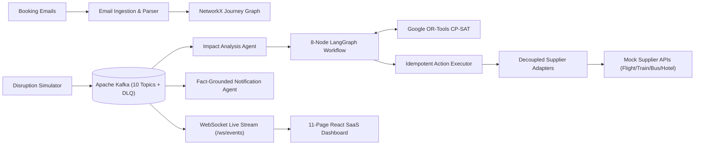

# AeroAI: Autonomous Disruption Recovery System

An AI-powered, event-driven travel disruption recovery platform that transforms individual travel bookings into a connected **NetworkX Journey Graph**, detects downstream cascading disruptions in real time, computes mathematically optimal recovery plans using **Google OR-Tools CP-SAT**, orchestrates autonomous decision-making via an **8-node LangGraph workflow**, executes idempotent supplier actions across a decoupled **Adapter Layer**, and streams live recovery updates over **Apache Kafka & WebSockets**.

---

## 1. Explicit Distinction: REAL vs. SIMULATED Subsystems

This project strictly separates **REAL** graph, mathematical optimization, event-driven, and agentic reasoning engines from **SIMULATED** third-party travel supplier transactions:

| Subsystem | Status | Implementation |
| :--- | :---: | :--- |
| **AI Reasoning & Impact Cascade Explanation** | **REAL** | `ImpactAnalysisAgent` + Gemini Structured Output / deterministic fallback |
| **Journey Graph & Connection Risk Engine** | **REAL** | `NetworkX` (`nx.DiGraph`) computing `SAFE`, `TIGHT`, and `IMPOSSIBLE` connections |
| **Downstream Dependency & Time-Gap Analysis** | **REAL** | Multi-hop graph traversal propagating delays and cancellations across itinerary legs |
| **Constraint Optimization Engine** | **REAL** | `Google OR-Tools CP-SAT` (`cp_model.CpModel` & `CpSolver`) 0-1 integer programming |
| **8-Node Autonomous Recovery Agent Workflow** | **REAL** | `LangGraph` (`StateGraph`) with confidence scoring, validation gates, and human escalation |
| **Event-Driven Architecture & WebSockets** | **REAL** | `Apache Kafka` (10 topics + `recovery.dlq`), correlation IDs, idempotent consumers, and WebSockets |
| **Anti-Hallucination Fact-Grounding Validator** | **REAL** | `FactGroundingValidator` verifying zero invented booking refs, prices, dates/times, or policy numbers |
| **Idempotent Action Executor & Rollback** | **REAL** | SHA-256 idempotency keys, timeout budgets, retries, and compensating booking reinstatement |
| **Airline / Train / Bus / Hotel Supplier APIs** | **SIMULATED** | Explicitly labeled **MOCK APIs** (`/flights`, `/trains`, `/buses`, `/hotels`, `/bookings/*`) |
| **Seat Inventory, Refunds & Email Inbox** | **SIMULATED** | In-memory Indian Golden Triangle datasets with configurable latency & fault injection |

---

## 2. System Architecture



---

## 3. Technology Stack

- **Backend**: Python 3.11+, FastAPI, SQLAlchemy 2.0, Pydantic v2, Uvicorn
- **Graph Engine**: NetworkX (`nx.DiGraph`)
- **Mathematical Optimization**: Google OR-Tools (`ortools.sat.python.cp_model`)
- **Agent Orchestration & AI**: LangGraph (`StateGraph`), Google GenAI SDK (`gemini-2.5-flash`)
- **Event Streaming**: Apache Kafka (`apache/kafka:3.7.0` KRaft + `confluent-kafka` / embedded broker) & FastAPI WebSockets
- **Frontend**: React 18, Vite, Tailwind CSS, Lucide Icons
- **Testing**: Pytest, FastAPI `TestClient` (47 automated unit, integration, and E2E tests)

---

## 4. Environment Variables

Create a `.env` file in the root or `backend/` directory (or use defaults for local zero-config execution):

```env
PROJECT_NAME="AeroAI: Autonomous Disruption Recovery System"
DATABASE_URL="sqlite:///./travel_recovery.db"
SECRET_KEY="super-secret-development-jwt-key-change-in-prod"
GEMINI_API_KEY=""
KAFKA_BOOTSTRAP_SERVERS="localhost:9092"
```

---

## 5. Setup & How to Run

### 1. Backend API Server (`http://127.0.0.1:8000`)

```powershell
python -m venv .venv
.\.venv\Scripts\Activate.ps1
pip install -r backend/requirements.txt

$env:PYTHONPATH="$PWD\backend"
.\.venv\Scripts\python -m uvicorn app.main:app --host 127.0.0.1 --port 8000 --reload
```

### 2. Frontend SaaS Dashboard (`http://127.0.0.1:5173`)

```powershell
cd frontend
npm install
npm run dev -- --host 127.0.0.1 --port 5173
```

### 3. Docker Compose (PostgreSQL + Redis + Apache Kafka KRaft + Kafka UI)

```bash
docker compose up --build -d
```

### 4. Automated Test Suite

```powershell
$env:PYTHONPATH="$PWD\backend"
.\.venv\Scripts\python -m pytest tests/backend/ -v -W ignore
```

---

## 6. Canonical 17-Step Golden Triangle Demo Instructions

### Scenario
- **Flight (`AI-202`)**: Mumbai → Delhi (`10:00 AM → 12:00 PM`)
- **Train (`12015-SHT`)**: Delhi → Jaipur (`1:30 PM → 5:30 PM`)
- **Hotel (`HTL-JAI-101`)**: Rambagh Heritage Palace Jaipur (Check-in `6:00 PM`, latest cutoff `10:00 PM`)
- **Tour (`TOUR-JAI-01`)**: Amber Fort Guided Tour (Next day `9:00 AM`)
- **Trigger**: Flight `AI-202` delayed **4 hours (`240 minutes`)** → revised Delhi arrival `4:00 PM (16:00)`.

### Run via API or Dashboard
1. **Via REST API**:
   ```bash
   curl -X POST http://127.0.0.1:8000/api/v1/recovery/demo/golden-triangle
   ```
   Returns `"all_17_steps_passed": true` with the full 17-step verification checklist, pre/disrupted/recovered graph summaries, OR-Tools optimization result (`TRN124` `17:30 → 21:00`), LangGraph explanation, 6 fact-grounded notifications, and audit trail.
2. **Via SaaS Frontend (`http://127.0.0.1:5173`)**:
   - Sign in with demo credentials (`traveler@example.com` / `password123`).
   - Explore all 11 views: **Dashboard**, **Inbox**, **My Journeys**, **Journey Details**, **Journey Graph**, **Disruption Center**, **Recovery Plan**, **Action History**, **Kafka Event Stream**, **Notifications**, and **Settings**.

---

## 7. Complete Documentation (`docs/`)

- [`docs/architecture.md`](docs/architecture.md) — High-level architecture & REAL vs. SIMULATED subsystem matrix
- [`docs/agents.md`](docs/agents.md) — 8-Node LangGraph workflow, confidence scoring & approval rules
- [`docs/journey-graph.md`](docs/journey-graph.md) — NetworkX DAG builder & connection risk engine
- [`docs/optimization.md`](docs/optimization.md) — Google OR-Tools CP-SAT mathematical formulation
- [`docs/kafka-events.md`](docs/kafka-events.md) — Apache Kafka topics, consumer groups, retries, DLQ & WebSockets
- [`docs/supplier-api.md`](docs/supplier-api.md) — Mock Supplier REST APIs, datasets & decoupled adapter pattern
- [`docs/demo-scenario.md`](docs/demo-scenario.md) — 17-step Golden Triangle walkthrough
- [`docs/setup.md`](docs/setup.md) — Local & Docker Compose setup instructions

---

## 8. Limitations & Future Production Architecture

### Current Prototype Limitations
- Third-party airline (GDS/NDC), railway (IRCTC), bus (RedBus), and hotel (OTA/PMS) bookings are **SIMULATED** via in-process Mock Supplier APIs.
- Email ingestion and notification delivery operate against a simulated inbox rather than live IMAP/OAuth2 and SMTP/SES relays.

### Future Production Architecture
- **Live GDS / NDC & Aggregator Adapters**: Swap `FlightSupplierAdapter`, `TrainSupplierAdapter`, and `HotelSupplierAdapter` implementations to connect to Amadeus/Sabre NDC, IRCTC B2B APIs, and Hospitality PMS webhooks without changing agent or optimizer code.
- **Distributed Kafka & Outbox Pattern**: Deploy multi-broker Apache Kafka with transactional outbox tables in PostgreSQL and Schema Registry (Avro/Protobuf).
- **Payment & Refund Escrow Gateway**: Integrate Stripe/Razorpay payment intents for fare-difference collection and automated refund settlement tracking.
