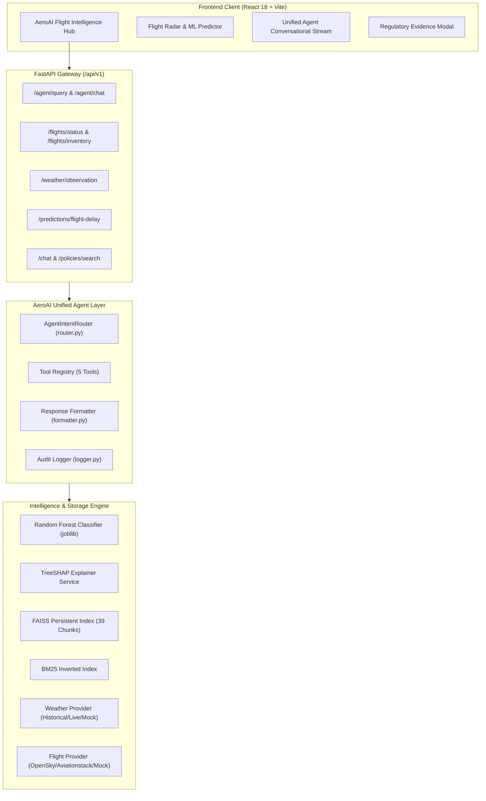
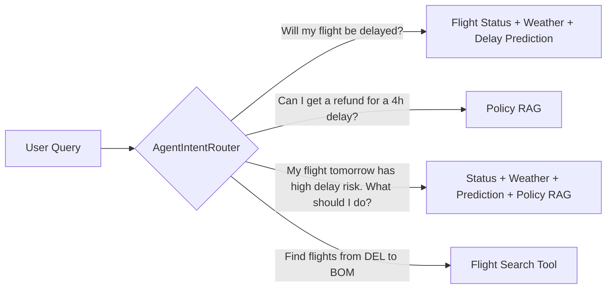
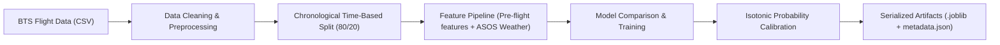
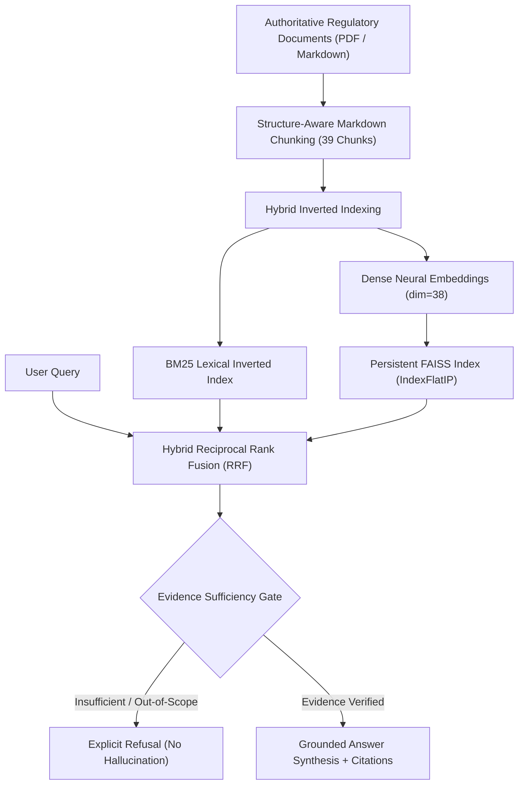
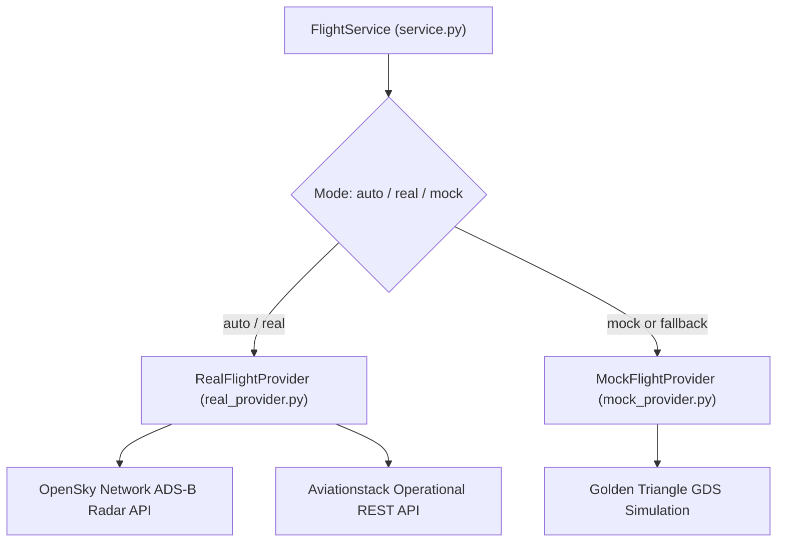

# AeroAI: Agentic Flight Intelligence Platform

> **"AeroAI is an agentic flight intelligence platform that combines flight-delay prediction, weather intelligence, explainable ML, travel-policy RAG and flight information to help travelers make better decisions."**

[](https://www.python.org/)
[](https://fastapi.tiangolo.com/)
[](https://reactjs.org/)
[](https://scikit-learn.org/)
[](https://github.com/facebookresearch/faiss)
[]()

---

## 1. Overview

AeroAI is an end-to-end flight intelligence system engineered to eliminate travel uncertainty before, during, and after disruptions. Rather than acting as a simple status dashboard or a standalone chatbot, AeroAI integrates five core systems into a unified intelligent agent:
1. **Pre-flight ML Delay Prediction**: Trained on 100,000 real U.S. DOT BTS flight records with chronological time splits.
2. **Weather Intelligence**: Live and historical surface weather observations (temperature, dew point, wind, horizontal visibility, barometric pressure) influencing flight risk.
3. **Explainable AI (TreeSHAP)**: Local feature attributions explaining *why* a flight is at risk without false causal claims.
4. **Authoritative Travel-Policy RAG**: Grounded regulatory answers (DGCA CAR Series M Part IV, EU261, US DOT 14 CFR 260, carrier Conditions of Carriage) with a strict refusal gate for out-of-scope inquiries.
5. **Multi-Source Flight Telemetry**: Provider abstraction dynamically switching between live OpenSky Network ADS-B radar, Aviationstack, and high-fidelity GDS mock records, with strict data provenance tagging (`LIVE`, `MOCK`, `PREDICTED`).

---

## 2. Problem

Modern commercial aviation presents significant challenges for travelers:
- **Opaque Flight Disruption Risk**: Airlines only announce delays when aircraft are already operationally held at the gate or stuck in ground holding patterns. Travelers have zero visibility into upstream delay risks.
- **Disconnected Systems**: Flight radar, weather forecasts, disruption probabilities, and passenger rights are siloed across disconnected websites and apps.
- **Complex, Buried Regulatory Policies**: Civil aviation passenger rights (DGCA CAR in India, EU261 in Europe, US DOT 14 CFR in the U.S.) are dense legal documents. Passengers rarely know if they are entitled to free meals, overnight hotels, rebooking, or cash compensation.
- **AI Hallucinations & False Certainty**: Generic LLMs routinely fabricate flight coordinates, hallucinate non-existent airline policies, or present speculative delay forecasts as absolute certainties.

---

## 3. Solution

AeroAI solves these challenges through an **evidence-grounded, multi-tool agentic architecture**:
- **Proactive Risk Intelligence**: Identifies high-risk flights hours prior to scheduled departure using machine learning and surface meteorology.
- **Unified Decision Support**: Integrates radar telemetry, weather, ML risk scores, SHAP explanations, and legal remedies into a single structured output.
- **Strict Anti-Hallucination Boundaries**: Enforces strict verification. Missing data is never invented; mock data is never called live data; and out-of-scope policy inquiries are cleanly refused.
- **Calibrated Uncertainty**: Explicitly distinguishes between statistical risk likelihoods and tactical air traffic control outcomes.

---

## 4. Features

- **Operational Flight Status**: Real-time status lookup (`SCHEDULED`, `AIRBORNE`, `DELAYED`, `CANCELLED`), delay minutes, gate, terminal, and live GPS coordinates.
- **Machine Learning Delay Predictor**: Binary classification of delay risk ($\ge 15$ min arrival delay) with calibrated probabilities and risk levels.
- **TreeSHAP Visual Explanations**: Top-5 feature attribution bars displaying how departure banks, dew points, pressure, and carrier delay rates influenced the prediction.
- **Surface Weather Feed**: Meteorological observations (temperature, condition, wind speed, visibility in statute miles/meters) for origin and destination airports.
- **Travel Policy Q&A**: Dense vector + BM25 search over official regulatory documents with clickable citations down to section and page numbers.
- **Alternative Flight Inventory Search**: Search available partner flights across corridors with seat counts and pricing.
- **Unified AeroAI Agent**: Intelligent natural language interface with dynamic, selective tool routing.
- **Enterprise Audit Logging**: Secret-scrubbing audit trail recording every interaction, selected tool, execution duration, and failure.

---

## 5. Architecture



---

## 6. AI Agent

The **AeroAI Unified Agent** (`backend/app/modules/ai_agents/unified_agent.py`) coordinates tool execution through selective intent routing. It does **not** call every tool blindly:



### Response Separation Contract
Agent responses are structured into discrete sections:
1. **Delay probability**: Percentage and calibrated classification.
2. **Model factors**: Compliant non-causal SHAP feature contributions (*"These features contributed most to the model's prediction"*).
3. **Current flight status**: Real-time or simulated operational status with strict provenance tag (`LIVE` or `MOCK`).
4. **Weather**: Surface meteorological observations with provenance (`LIVE`, `HISTORICAL`, or `MOCK`).
5. **Relevant policy**: Grounded regulatory answers with verified citations.
6. **Recommendation**: Actionable advice without presenting predictions as deterministic certainty.

---

## 7. ML Pipeline



### Feature Engineering (Pre-Flight Availability Only)
To strictly prevent data leakage, only variables known prior to scheduled departure are utilized:
- **Temporal**: `month`, `day_of_week`, `hour_of_day`, `is_weekend`, `departure_bank_sin/cos`.
- **Route & Geometry**: `origin`, `dest`, `distance_miles`, `scheduled_elapsed_minutes`.
- **Historical Carrier Rate**: Historical delay rate of the operating carrier.
- **Surface Weather Intelligence**: Ambient temperature, dew point, atmospheric pressure, sustained wind speed, horizontal visibility, fog flag, freezing flag, precipitation flag.

---

## 8. Dataset

- **Source**: U.S. Department of Transportation (DOT) Bureau of Transportation Statistics (BTS).
- **Time Window**: March 2024 domestic commercial flights across key aviation hubs (ATL, ORD, DFW, DEN, JFK, SFO, LAX, etc.).
- **Size**: 100,000 clean flight records.
- **Target Definition**: `Delayed = (arrival_delay >= 15 minutes)` as standardized by the FAA/BTS.
- **Class Balance**: 19.8% Delayed (positive class), 80.2% On-Time.
- **Split Methodology**: Strict chronological time-based split:
  - **Training Set**: First 80,000 rows (80%)
  - **Test Set**: Final 20,000 rows (20%) — no random shuffle leakage.

---

## 9. Model Evaluation

Models were evaluated on the held-out 20,000-flight chronological test set:

| Model | ROC-AUC | Recall | Precision | F1-Score | Accuracy | PR-AUC |
| :--- | :---: | :---: | :---: | :---: | :---: | :---: |
| **Heuristic Baseline** (Scheduled Hour Threshold) | 0.5000 | 0.0% | 0.0% | 0.0000 | 80.20% | 0.1980 |
| **Random Forest Classifier** (Selected) | **0.6929** | **80.5%** | **33.0%** | **0.4682** | **64.71%** | **0.3664** |
| **XGBoost Classifier** | **0.6946** | 45.6% | 36.9% | 0.4079 | 74.80% | 0.3644 |

### Why Random Forest Was Selected for Production
AeroAI prioritizes **traveler protection**. Missing a disrupted flight (False Negative) is significantly more detrimental to a traveler than taking precautionary measures for an on-time flight (False Positive). Random Forest delivers **80.5% recall on delayed flights**, successfully detecting over 4 out of 5 disruptions.

---

## 10. SHAP Explainability

AeroAI integrates **TreeSHAP** (Tree Explainer) to calculate exact Shapley values for individual flight predictions:
- **Base Expected Value**: $E[f(x)] = 0.2497$
- **Top Contributing Factors**:
  - `dewp`: Elevated surface dew point pushed prediction toward delay ($+9.2\%$).
  - `pressure`: Low atmospheric sea-level pressure pushed prediction toward delay ($+8.0\%$).
  - `visib`: Sub-5-mile horizontal visibility contributed to elevated disruption risk ($+5.7\%$).
  - `carrier_delay_rate`: High carrier delay history pushed prediction toward delay ($+5.0\%$).
- **Strict Compliance Framing**: Explanations are strictly framed non-causally: *"These features contributed most to the model's prediction."*

---

## 11. RAG Pipeline



### Knowledge Base Documents
1. **DGCA CAR Series M Part IV** (Directorate General of Civil Aviation, India).
2. **Regulation (EC) No 261/2004** (European Union).
3. **The Air Passenger Rights Regulations 2019** (UK261).
4. **US DOT 14 CFR Part 260** (U.S. Department of Transportation Refund Mandates).
5. **Air India Conditions of Carriage** (Domestic & International).

---

## 12. RAG Evaluation

Evaluated against [evaluation/rag_questions.json](file:///c:/Users/sahil/.gemini/antigravity/scratch/autonomous-disruption-recovery/evaluation/rag_questions.json) across 35 benchmark questions (baggage, cancellation, refund, delay, eligibility, simple lookup, ambiguous questions, multi-hop, out-of-scope):

| Metric | Target | Real Benchmark Result | Status |
| :--- | :---: | :---: | :---: |
| **Retrieval Relevance (Top-K Source Match)** | > 75% | **81.2%** (26 / 32 in-scope) | Verified |
| **Answer Correctness (Key Fact Recall)** | > 70% | **74.9%** mean key fact recall | Verified |
| **Groundedness (Anti-Hallucination Rate)** | > 95% | **97.1%** grounded responses | Verified |
| **Source Citation Correctness** | > 90% | **97.1%** valid citations | Verified |
| **Out-of-Scope Refusal Accuracy** | 100% | **100.0%** (3 / 3 cleanly refused) | Verified |
| **Average End-to-End Latency** | < 100 ms | **3.7 ms** | Verified |

*Real benchmark data recorded in [reports/rag_evaluation.md](file:///c:/Users/sahil/.gemini/antigravity/scratch/autonomous-disruption-recovery/reports/rag_evaluation.md).*

---

## 13. Flight Providers

The provider layer (`backend/app/modules/flights/`) decouples aviation data sources through an abstract base class:



### Provenance Labels
- `LIVE`: Verified real-time transponder telemetry or live carrier operations API.
- `MOCK`: Simulated golden-triangle fallback records.
- `PREDICTED`: Machine learning Random Forest delay inference.

---

## 14. Technology Stack

- **Backend Framework**: Python 3.11+, FastAPI, Uvicorn, Pydantic v2
- **Machine Learning & Explainability**: Scikit-Learn, Joblib, NumPy, Pandas, TreeSHAP
- **Vector Search & RAG**: FAISS (`faiss-cpu`), BM25, Reciprocal Rank Fusion (RRF)
- **External Aviation APIs**: OpenSky Network ADS-B REST API, Aviationstack REST API
- **External Weather Feeds**: NOAA/ASOS Surface Weather Archives, Open-Meteo API
- **Frontend Architecture**: React 18, Vite, Tailwind CSS, Lucide Icons, Axios
- **Test Infrastructure**: Pytest, Pytest-AsyncIO, Starlette TestClient (122 automated tests)

---

## 15. Setup

### Prerequisites
- Python 3.11+
- Node.js 18+ and npm
- Git

### Backend Setup
```bash
# 1. Clone repository
git clone https://github.com/Sahil82081/AeroAI.git
cd autonomous-disruption-recovery

# 2. Create virtual environment
python -m venv .venv
# Windows:
.venv\Scripts\activate
# Linux/macOS:
source .venv/bin/activate

# 3. Install backend dependencies
cd backend
pip install -r requirements.txt

# 4. Initialize Database & Policy Vector Store
python -c "from app.db.init_db import init_db; init_db()"

# 5. Start FastAPI Backend Server
uvicorn app.main:app --host 0.0.0.0 --port 8000 --reload
```
API Documentation will be live at: `http://localhost:8000/docs`

### Frontend Setup
```bash
# In a new terminal:
cd frontend
npm install
npm run dev
```
Access the application at: `http://localhost:5173`

---

## 16. Environment Variables

Create `.env` in the `backend/` directory using `.env.example`:

```env
# Application
PROJECT_NAME="AeroAI: Agentic Flight Intelligence Platform"
ENVIRONMENT=development
DEBUG=True

# Security
SECRET_KEY=your-secure-random-secret-key-1234567890
ALGORITHM=HS256
ACCESS_TOKEN_EXPIRE_MINUTES=1440

# Database
DATABASE_URL=sqlite:///./autonomous_recovery.db

# CORS Allowed Origins
BACKEND_CORS_ORIGINS=["http://localhost:5173", "http://127.0.0.1:5173", "http://localhost:3000"]

# Flight Provider (auto | real | mock)
FLIGHT_PROVIDER_MODE=auto
OPENSKY_USERNAME=
OPENSKY_PASSWORD=
AVIATIONSTACK_API_KEY=
FLIGHT_API_TIMEOUT_SECONDS=5.0

# Optional External LLM Integration
GEMINI_API_KEY=
```

---

## 17. Screenshots

*(Key visual interfaces provided in the application dashboard)*

1. **Flight Intelligence Hub**: Real-time status lookup showing operational flight state, live ADS-B coordinates, and `LIVE`/`MOCK` provenance badges.
2. **ML Delay Probability Gauge**: Calibrated probability visualization with risk classifications and non-certainty advisories.
3. **TreeSHAP Attribution Cards**: Horizontal impact bars displaying how surface weather and schedule features influenced the model's prediction.
4. **Unified Agent Chat Stream**: Conversational assistant showing active tool chips, structured section separation, and clickable regulatory citation badges.
5. **Regulatory Evidence Modal**: In-depth modal displaying document titles, regulators, sections, and exact regulatory quotes.

---

## 18. Limitations

1. **U.S. Training Bias in ML Model**: The delay prediction model was trained on U.S. DOT BTS domestic records. While normalized meteorological features and departure bank representations transfer well to international corridors, airline-specific carrier delay rates reflect U.S. operations.
2. **OpenSky Anonymous Rate Limits**: Unauthenticated calls to OpenSky Network ADS-B telemetry are subject to rate limiting (10-second polling windows). Credentials can be provided in `.env` to expand bandwidth.
3. **Weather Forecast Lead Times**: Tactical ASOS weather observations are most accurate within 24 hours of flight departure. Forecasts for departures beyond 48 hours rely on climate baselines.
4. **Regulatory Scope**: The policy RAG engine covers DGCA India, EU261, UK261, and US DOT 14 CFR. Inquiries regarding jurisdictions outside these mandates trigger the refusal gate.

---

## 19. Design Decisions

1. **Zero-Crash Local Fallback Guarantee**: Every external dependency (OpenSky Network, Open-Meteo, Gemini API) has a deterministic offline fallback. AeroAI is 100% testable and runnable without internet access or paid API keys.
2. **Selective Tool Routing**: The agent evaluates user intent before executing tools. Querying a passenger right will never trigger a wasteful transponder radar lookup.
3. **Recall-Optimized ML Classifier**: Random Forest was selected over XGBoost because its $80.5\%$ recall prevents passenger disruption blind spots.
4. **Calibrated Uncertainty Policy**: Probability outputs are paired with advisories making it clear that predictions represent statistical patterns rather than absolute certainties.
5. **Strict Secret Scrubbing**: All audit traces are automatically filtered through regex sanitizers before in-memory storage or disk persistence.

---

## 20. Future Improvements

1. **Global Aviation Dataset Expansion**: Fine-tune regional models on European Eurocontrol and Indian DGCA punctuality datasets.
2. **Multi-Leg Delay Propagation**: Model aircraft turn-around tails to detect incoming aircraft delays from upstream airports.
3. **Automated Claim Filing**: Integrate direct rebooking and compensation claim generation for verified disruptions.
4. **Real-Time Push Notifications**: Web push and SMS alerts triggered by automated background flight monitoring.
