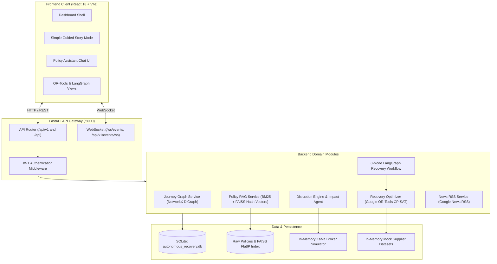

# TripWeave AI (AeroAI) — Current Architecture Audit

> **Document Version**: 1.0.0 (Stage 0 Baseline Audit)  
> **Date**: October 2026  
> **Branch**: `dev`  
> **Scope**: Complete repository inspection, subsystem classification, security analysis, and gap evaluation.

---

## 1. Executive Summary

The repository currently exists as **AeroAI: Autonomous Disruption Recovery System**, a proof-of-concept / demo application focused on downstream travel disruption propagation, constraint optimization using Google OR-Tools CP-SAT, and an 8-node LangGraph recovery state machine for an Indian Golden Triangle multi-leg itinerary.

While the existing system contains sophisticated graph mechanics (NetworkX) and discrete mathematical optimization (OR-Tools CP-SAT), **it currently lacks the core machine learning and unified agentic capabilities** expected in a production-grade AI/ML engineering portfolio:
1. **Zero Flight Delay ML Models**: No training pipeline, no real aviation dataset, no scikit-learn/XGBoost models, and no feature engineering exist in the repository. Disruption events are manually triggered or hardcoded.
2. **Zero Weather Integration**: Weather is merely an enum value (`DisruptionType.WEATHER`) without real or historical weather data integration.
3. **Pseudo-Vector RAG Engine**: The policy search claims semantic vector retrieval via FAISS, but the underlying vector computation is an MD5 hash-projection modulo 128 (feature hashing) rather than true dense semantic embeddings. When LLM keys are absent, answer synthesis falls back to a brittle string-matching keyword heuristic.
4. **Isolated Subsystems**: The 8-node LangGraph workflow, the policy RAG chatbot, the mock suppliers, and the news feed operate as separate silos rather than a coordinated agentic system.

---

## 2. Current Architecture & Technology Stack

### 2.1 High-Level Architecture Diagram



### 2.2 Technology Stack Matrix

| Layer | Component | Version / Library | Purpose |
| :--- | :--- | :--- | :--- |
| **Backend Framework** | FastAPI | `0.115.8` | REST API endpoints, OpenAPI docs, WebSocket endpoints |
| **Server / ASGI** | Uvicorn | `0.34.0` | Async server gateway interface |
| **Data Validation** | Pydantic / Pydantic Settings | `^2.10.0` / `^2.7.0` | Schema validation and configuration management |
| **Database ORM** | SQLAlchemy | `2.0.38` | Relational ORM mapping for Journeys, Bookings, Disruptions |
| **Database Engine** | SQLite (dev) / PostgreSQL (docker) | `3.x` / `16-alpine` | Relational persistence |
| **Graph Modeling** | NetworkX | `3.4.2` | Directed Acyclic Graph (`nx.DiGraph`) modeling itinerary legs and connection buffers |
| **Mathematical Optimization** | Google OR-Tools CP-SAT | `9.15.6755` | 0-1 Integer Linear Programming solver for rebooking selection |
| **Agent Orchestration** | LangGraph / LangChain Core | `1.2.15` / `1.6.10` | 8-node state machine for post-disruption execution |
| **Vector Search** | FAISS-cpu | `^1.15.1` | IndexFlatIP nearest-neighbor vector search |
| **Document Ingestion** | BeautifulSoup4 / PyPDF | `^4.12.0` / `^5.0.0` | HTML / PDF extraction for airline carriage and passenger rights policies |
| **Feed Parser** | feedparser | `^6.0.10` | Google News RSS feed aggregation |
| **Frontend Framework** | React / Vite | `18.x` / `8.3.4` | Single Page Application (SPA) dashboard |
| **Styling & Icons** | Tailwind CSS / Lucide React | `3.4.x` / `^1.16.0` | Dark-themed UI components and icon sets |
| **Containerization** | Docker / Docker Compose | Compose v2 | Multi-container setup (Postgres, Kafka KRaft, Backend, Frontend) |

---

## 3. Subsystem Breakdown: Real vs. Mock vs. Synthetic

| Subsystem | Classification | Implementation Reality | Gaps & Evaluation |
| :--- | :---: | :--- | :--- |
| **Flight Delay Prediction** | **MISSING** | Non-existent. Delays are hardcoded (e.g. `240` minutes) or manually inputted into `/disruptions/simulate`. | Needs real aviation training dataset (BTS/Kaggle), baseline/RF/XGBoost comparison, and SHAP explainability. |
| **Weather Information** | **MISSING** | String enum value only. No meteorological observations or forecasts. | Needs `WeatherProvider` interface with historical and live weather capabilities. |
| **Flight Inventory & Status** | **MOCK / SIMULATED** | Static in-memory Python dictionaries (`mock-suppliers/datasets.py`). No real-time aviation API integration. | Needs `FlightProvider` abstraction with `MockFlightProvider` fallback and real flight provider (`OpenSkyFlightProvider`). |
| **Journey Dependency Graph** | **REAL** | `networkx.DiGraph` computing connection time gaps and buffer erosion (`SAFE`, `TIGHT`, `IMPOSSIBLE`). | Solid algorithmic foundation; handles multi-hop cascades. |
| **Recovery Optimization** | **REAL** | Google OR-Tools CP-SAT formulation with 6 configurable objective weights and constraints. | Functioning mathematical solver, but only operates after a disruption is manually triggered. |
| **8-Node Recovery Workflow** | **REAL** | LangGraph `StateGraph(RecoveryAgentState)` with verification and retry loops. | Works for executing alternative bookings, but is NOT a conversational agent and cannot answer user queries. |
| **Policy Ingestion & Retrieval** | **MIXED** | Real policy documents parsed from PDF/HTML into chunks; hybrid BM25 search. | Dense vector retrieval uses an MD5 hash trick instead of real embeddings. |
| **Policy Answer Generation** | **MIXED** | Calls Gemini API if `GEMINI_API_KEY` is present; falls back to hardcoded regex/keyword strings. | Vulnerable to heuristic failure on queries outside hardcoded keywords; lacks benchmarked RAG evaluation. |
| **Travel News Feed** | **REAL** | Fetches live Google News RSS items via `feedparser`. | Functional external API integration with in-memory TTL caching. |
| **Kafka Event Broker** | **SIMULATED** | Embedded in-process event pipeline with fallback when local Kafka broker is absent. | Great for zero-config testing; Docker compose configures real KRaft Kafka broker. |

---

## 4. End-to-End Data & Processing Flows

### 4.1 Current Disruption Recovery Flow
```
User / Test Runner
   ↓ (POST /api/v1/recovery/demo/golden-triangle or /disruptions/simulate)
Disruption Simulator Engine
   ↓ (updates Booking status to DELAYED, extends end_time)
NetworkX Journey Graph Engine
   ↓ (recalculates connection buffers: Delhi flight-to-train gap drops from +90m to -150m IMPOSSIBLE)
Impact Analysis Agent
   ↓ (flags Train 12015-SHT as MISSED_CONNECTION, Hotel as SCHEDULE_THREATENED)
Candidate Alternative Search
   ↓ (queries mock supplier dataset for trains departing Delhi after revised arrival)
Google OR-Tools CP-SAT Solver
   ↓ (selects Train TRN124 17:30->21:00, meeting hotel check-in cutoff < 22:00)
8-Node LangGraph Coordinator
   ↓ (validates confidence 0.94, executes rebooking, hotel modification, refund via Mock Adapters)
Notification Agent
   ↓ (generates 6 templated notifications, stores in-memory)
```

### 4.2 Current Policy RAG Flow
```
User Query ("What compensation do I get for a 4-hour delay?")
   ↓ (POST /api/chat)
PolicyRAGService.answer_question()
   ↓
Query Rewrite & Active Journey Context Extraction
   ↓
Hybrid Search:
   ├── BM25 Keyword Scoring (Robertson-Spärck Jones IDF over inverted index)
   └── FAISS Inner Product Search (Query converted via MD5 character-hash modulo 128)
   ↓
Reciprocal Rank Fusion (RRF) Re-ranking
   ↓
Answer Synthesis:
   ├── IF GEMINI_API_KEY available: Prompt sent to Gemini 2.5 Flash
   └── ELSE: Deterministic heuristic string matcher:
             `if any(w in q_lower for w in ["delay", "delayed", ...]): return hardcoded text`
```

---

## 5. Security & Configuration Audit

1. **Hardcoded Secrets**:
   - `backend/app/core/config.py` contains a hardcoded fallback:
     `SECRET_KEY: str = "super-secret-dev-key-change-in-production-1234567890"`
   - `backend/.env` contains the same default key.
   - `docker-compose.yml` uses hardcoded default database credentials (`postgres:postgres`).
2. **CORS Policy**:
   - In `backend/app/main.py`:
     ```python
     allow_origins=settings.BACKEND_CORS_ORIGINS if settings.BACKEND_CORS_ORIGINS else ["*"]
     ```
     If `BACKEND_CORS_ORIGINS` is unset, it defaults to wildcard `["*"]` with `allow_credentials=True`, which is an insecure configuration.
3. **API Key Exposure**:
   - `GEMINI_API_KEY` is read from environment variables; no raw API keys are committed to Git, but `.env.example` should clearly document how to configure it.
4. **JWT & Session Security**:
   - JWT tokens are stored in the browser's `localStorage` (`adr_access_token`), vulnerable to XSS if malicious scripts are injected.

---

## 6. Codebase Health, Redundancies & Dead Code

1. **Unused Boilerplate Files**:
   - `frontend/src/main.ts` (Vite template counter and HTML string injection, unused because `index.html` loads `main.jsx`).
   - `frontend/src/counter.ts` (Vite starter counter, completely unused).
   - `frontend/src/style.css` (Vite starter CSS, unused because `index.css` is imported).
   - `services/` (Empty root directory).
   - `tests/frontend/` (Empty test directory).
   - `backend/app/modules/ai_agents/agent_stub.py` (Unused 19-line placeholder class `AgentRecoveryEngineStub`).
2. **Duplicate Code & Datasets**:
   - `mock-suppliers/datasets.py` and `backend/app/datasets/mock_datasets.py` contain duplicate flight/train/hotel mock lists.
   - Root `autonomous_recovery.db` (106 KB) and `backend/autonomous_recovery.db` (94 KB) represent duplicate SQLite databases resulting from running the application from different working directories.
3. **Environment & Path Friction**:
   - Pytest fails with `ModuleNotFoundError: No module named 'app'` unless `$env:PYTHONPATH="$PWD\backend"` is manually set before running. A `pytest.ini` or `pyproject.toml` configuration is needed to make test execution seamless.

---

## 7. Gap Analysis Against Target TripWeave AI Platform

| Requirement | Current State | Required Target State |
| :--- | :--- | :--- |
| **1. Flight Delay Prediction** | Non-existent | Real aviation dataset (BTS/Kaggle), clean pre-flight feature engineering, leakage prevention, baseline/RF/XGBoost models. |
| **2. Weather Integration** | Non-existent | `WeatherProvider` interface with historical and live weather data. |
| **3. Model Training & Evaluation** | Non-existent | Time-based data split, ROC-AUC, Precision, Recall, F1, PR-AUC, confusion matrix, documented in `reports/model_evaluation.md`. |
| **4. Explainability** | Non-existent | SHAP feature contribution analysis; clear distinction between statistical attribution and causality. |
| **5. Policy RAG System** | Hash-projection pseudo-embeddings + heuristic string matching fallback | True dense embeddings, citation attribution, refusal when evidence is missing. |
| **6. RAG Evaluation** | Non-existent | 30+ curated question benchmark (`evaluation/rag_questions.json`), retrieval relevance, groundedness, reported in `reports/rag_evaluation.md`. |
| **7. Real Flight Data Provider** | In-memory mock list | `FlightProvider` abstraction supporting `MockFlightProvider` and real aviation provider (`OpenSkyFlightProvider`). |
| **8. Unified AI Agent** | Disconnected recovery LangGraph (post-disruption only) | Unified `TripWeave Agent` dynamically selecting Flight Tool, Weather Tool, Delay Prediction Tool, and Policy RAG Tool based on intent. |
| **9. Grounded Evidence Response** | Separate endpoints | Unified response separating ML Prediction, Live Status, Weather, Policy Citations, and LLM Recommendations. |
| **10. Architecture & Documentation** | AeroAI disruption recovery demo | TripWeave AI agentic flight intelligence platform with production documentation. |

---

## 8. Summary & Transition to Stage 1

The repository has strong foundations in event-driven recovery, graph traversal, and mathematical constraint satisfaction. The next step is executing **Stage 1 (Real Flight Delay Data)** to build the machine learning backbone without breaking the existing graph and optimization engines.
