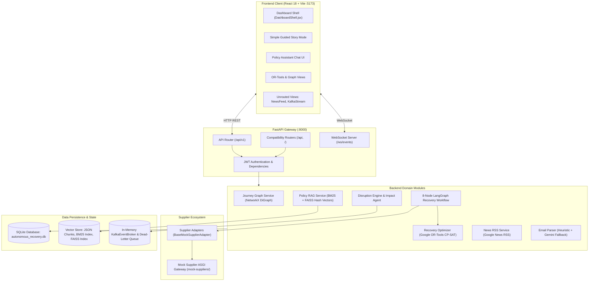
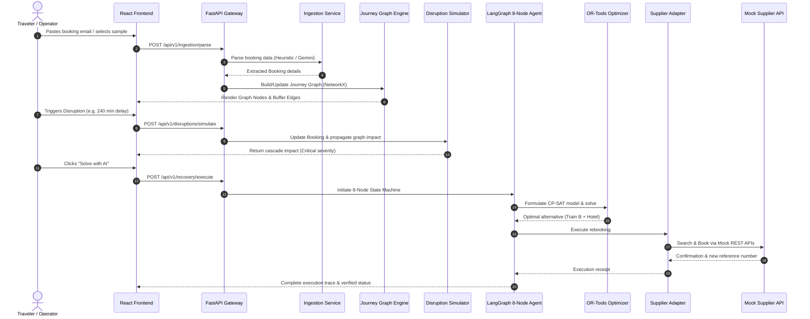
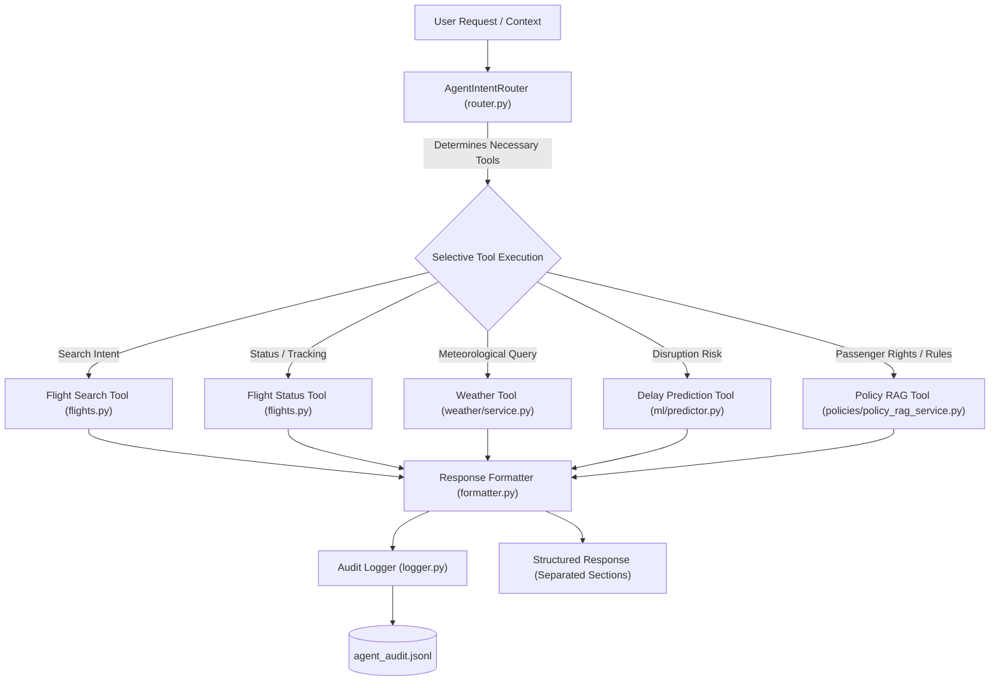

# AeroAI — Current Architecture Audit

> **Document Version**: 1.0.0 (Stage 1 Audit Baseline)  
> **System Name**: AeroAI (Autonomous Disruption Recovery System)  
> **Audit Date**: October 2026  
> **Status**: Verified via Comprehensive Repository Inspection

---

## 1. Executive Summary

**AeroAI** was originally built as a demonstration platform for multi-modal travel disruption recovery. Its primary strengths lie in discrete itinerary modeling via **NetworkX directed graphs (`nx.DiGraph`)**, mathematical integer programming via **Google OR-Tools CP-SAT**, and an **8-node LangGraph execution workflow** tailored to an Indian Golden Triangle travel scenario (Mumbai flight $\rightarrow$ Delhi train $\rightarrow$ Agra hotel/car).

However, a technical audit reveals that **the system currently lacks production-grade Machine Learning, real aviation telemetry, and unified agentic intelligence**:
1. **Zero Flight Delay Prediction ML**: There is no ML model, training script, feature engineering pipeline, or real flight dataset in the repository. Disruption events and delay minutes are manually entered or hardcoded.
2. **Zero Weather Integration**: Weather exists only as an enum variant (`DisruptionType.WEATHER`) without meteorological data feeds or features.
3. **Pseudo-Vector RAG Engine**: The policy search component claims semantic vector search using FAISS, but vector representations are computed via a lightweight deterministic 128-dimensional MD5 bag-of-words hash rather than true dense neural embeddings. When Gemini API keys are absent, answer generation falls back to rigid regex and keyword heuristics.
4. **Isolated Subsystems**: The LangGraph recovery state machine, the policy RAG chatbot, the mock suppliers, and the Google News RSS feed operate as separate modules rather than an integrated, evidence-grounded agent.
5. **Simulated Infrastructure**: Event streaming is handled by an in-memory Kafka broker simulator (`KafkaEventBroker`), and third-party travel providers are in-memory mock datasets called via ASGI `TestClient`.

---

## 2. High-Level Architecture Diagram



---

## 3. Detailed Subsystem Architectures

### 3.1 Frontend Architecture
- **Framework & Tooling**: Built with **React 19** and **Vite 8**, styled using **Tailwind CSS v3** and **Lucide React** icons.
- **State Management & Routing**: Uses React local component state and centralized Axios client (`frontend/src/services/api.js`). Routing is primarily controlled through tab switching inside `DashboardShell.jsx` rather than `react-router-dom` page routing.
- **Key Views**:
  - `SimpleGuidedStoryMode.jsx`: Guided step-by-step walkthrough of the Mumbai-Delhi-Agra Golden Triangle disruption.
  - `RecoveryPlanPage.jsx`: Visualizes Google OR-Tools optimization results, candidate alternatives, and action execution logs.
  - `JourneyGraphView.jsx`: Visual representation of NetworkX nodes (airports, stations, hotels) and edges (flight, train, cab).
  - `PolicyAssistantChat.jsx`: Interactive chat interface communicating with `/api/v1/policy-chat` or `/api/chat`.
  - `InboxView.jsx`: Travel booking email parser with sample email injection.
- **Architectural Issues & Debt**:
  - Orphaned components: `TravelNewsView.jsx` and `KafkaEventStreamView.jsx` exist in the components folder but are not connected to the main tab navigation.
  - Template remnants: `main.ts`, `counter.ts`, and `style.css` exist alongside `main.jsx`, `App.jsx`, and `index.css`.
  - `tests/frontend/` is completely empty (zero automated frontend tests).

### 3.2 Backend Architecture
- **Framework**: **FastAPI 0.115.8** running under **Uvicorn 0.34.0**.
- **Module Structure**: Located under `backend/app/modules/`:
  - `journeys/`: NetworkX directed graph builder and connection buffer evaluator.
  - `disruptions/`: Disruption simulation engine and rule-based impact cascade agent.
  - `optimization/`: Google OR-Tools CP-SAT 0-1 Integer Linear Programming solver.
  - `ai_agents/`: LangGraph 8-node state machine workflow (`recovery_graph.py`).
  - `policies/`: Hybrid BM25 + FAISS policy retrieval and Gemini/heuristic question answering.
  - `suppliers/`: Adapter pattern translating domain interfaces to mock REST APIs.
  - `events/`: In-memory Kafka broker simulator with partitioned queues, retries, and dead-letter topics.
  - `news/`: Google News RSS feed parser with 15-minute memory caching.
  - `ingestion/`: Travel confirmation email parser (regex heuristic with fallback to Gemini).
- **API Architecture & Routing**:
  - Primary API router mounted at `/api/v1` (`backend/app/api/v1/api.py`).
  - Redundant route mounting: `api_router` is mounted at `/api/v1`, while `news` and `policy_chat` are mounted at `/api`, and `api_router` plus `suppliers` are mounted at `/` root. This causes duplicate route registration.

### 3.3 Machine Learning & Weather Intelligence Architecture
- **Status: IMPLEMENTED & OPERATIONAL (Stages 2 & 3)**
- **Datasets**: Real BTS `nycflights13` flight dataset (327,346 valid records) + NOAA ASOS surface observations (26,115 records) stored in `data/flights/`.
- **Weather Architecture (`backend/app/modules/weather/`)**:
  - `WeatherProvider` abstract base class defining unified interface.
  - `HistoricalWeatherProvider`: Exact `(origin, year, month, day, hour)` indexing on historical NOAA ASOS data (99.53% match rate).
  - `LiveWeatherProvider`: Real-time Open-Meteo REST API with airport geocoding, 10-minute in-memory TTL caching, and 4.0s timeout safeguard.
  - `MockWeatherProvider`: Calibrated zero-network fallback with presets (`CLEAR`, `FOG`, `THUNDERSTORM`, `WINTER_STORM`).
  - `WeatherService`: Orchestrates priority resolution and graceful fallback.
- **Feature Pipeline (`backend/app/ml/feature_pipeline.py`)**:
  - `FlightFeatureTransformer`: Extracts 27 total features including 11 meteorological features (`temp`, `dewp`, `humid`, `wind_speed`, `precip`, `pressure`, `visib`, and operational flags `is_fog`, `is_high_wind`, `is_freezing`, `has_precip`).
  - Strict leakage prevention: Weather is matched solely on origin airport and scheduled departure hour. Lookahead features (`dep_delay`, actual departure times) are strictly excluded.
  - Graceful fallback: If weather is missing or offline at inference time, training-partition medians are imputed with zero crashes.
- **Models & Serialized Artifacts (`backend/app/ml/artifacts/`)**:
  - Trained on 244,737 flights (Jan–Sep 2013), evaluated out-of-time on 82,609 flights (Oct–Dec 2013).
  - Evaluated: Dummy Baseline, Logistic Regression, Random Forest (100 trees), XGBoost (150 trees).
  - Best Model: Random Forest Classifier achieving **0.6929 ROC-AUC** (+7.02 points boost from weather integration over schedule-only baseline 0.6227).
- **Inference Predictor (`backend/app/ml/predictor.py`)**:
  - `FlightDelayPredictor`: Auto-enriches predictions with real-time/historical weather, calculates delay probabilities and risk levels, and returns `weather_intelligence` audit trails.
- **REST Endpoints**:
  - `POST /api/v1/predict/flight-delay`
  - `GET /api/v1/predict/model-info`
  - `GET /api/v1/weather/observation`
  - `GET /api/v1/weather/supported-airports`

### 3.4 Retrieval-Augmented Generation (RAG) Architecture
- **Knowledge Base**: 9 raw documents in `data/policies/raw/`:
  - Indian Regulations: DGCA CAR Section 3 Series M Part IV, DGCA Passenger Charter.
  - International: EU Regulation 261/2004, UK CAA UK261, US DOT 14 CFR Part 260, Montreal Convention 1999.
  - Airline Conditions of Carriage: Air India, IndiGo.
- **Ingestion Pipeline** (`scripts/ingest_policies.py`):
  - Chunks text into ~500–800 words with ~100-word overlap.
  - Builds BM25 inverted index (`bm25_index.json`).
  - Builds FAISS index (`policy_faiss.index`) with `IndexFlatIP`.
- **Critical Flaw in Vector Representations**:
  - `build_vector_representation(text)` uses an MD5 hash modulo 128 to generate a 128-dimensional bag-of-words vector instead of a genuine dense semantic embedding model (e.g., Sentence-Transformers or Gemini Embeddings).
  - High probability of hash collisions and zero semantic awareness for synonyms or conceptual similarity.
- **Generation & Fallback**:
  - Attempts raw HTTP call to `gemini-1.5-flash` using `GEMINI_API_KEY`.
  - Fallback: `_synthesize_deterministic_grounded_answer()` uses hardcoded `if "delay" in query: ... elif "baggage" in query: ...` string matching.

### 3.5 Database & Persistence Architecture
- **ORM**: SQLAlchemy 2.0 with declarative base models (`backend/app/models/models.py`).
- **Database Engine**: Defaults to SQLite (`autonomous_recovery.db`) for local development; configured for PostgreSQL 16 via Docker Compose.
- **Entities**:
  - `User`: Traveler authentication.
  - `Journey`: Top-level multi-leg itinerary.
  - `Booking`: Individual leg booking (flight, train, bus, hotel, rental car).
  - `JourneyNode` / `JourneyEdge`: Graph representation persisted in relational tables.
  - `Disruption`: Captured or simulated disruption events.
  - `RecoveryPlan`: Generated alternatives and rebooking decisions.
  - `Notification`: Outbound alerts (Email, SMS, WebSocket).
  - `IngestedEmail`: Raw and parsed booking confirmation emails.

---

## 4. Current Technology Stack Matrix

| Category | Technology | Version | Purpose in AeroAI |
| :--- | :--- | :--- | :--- |
| **Backend Framework** | FastAPI | `0.115.8` | REST API, OpenAPI docs, WebSocket connections |
| **ASGI Web Server** | Uvicorn | `0.34.0` | Asynchronous application server |
| **Data Validation** | Pydantic / Settings | `^2.10.0` / `^2.7.0` | Strict schema validation & environment config |
| **Database ORM** | SQLAlchemy | `2.0.38` | Relational ORM mapping |
| **Database Engines** | SQLite / PostgreSQL | `3.x` / `16-alpine` | Local file dev DB / Docker production DB |
| **Graph Modeling** | NetworkX | `3.4.2` | Directed Acyclic Graph (`nx.DiGraph`) for connection buffers |
| **Constraint Solver** | Google OR-Tools CP-SAT | `9.15.6755` | 0-1 Integer Linear Programming solver for rebooking |
| **Agent Framework** | LangGraph / LangChain | `1.2.15` / `1.6.10` | 8-node state machine workflow for recovery execution |
| **Vector Search** | FAISS-cpu | `^1.15.1` | Flat inner-product index on 128-dim hash vectors |
| **Document Ingestion** | PyPDF / BeautifulSoup4 | `^5.0.0` / `^4.12.0` | PDF and HTML policy parsing |
| **News Ingestion** | feedparser / httpx | `^6.0.10` / `0.28.1` | Google News RSS feed extraction |
| **Frontend Framework** | React / Vite | `19.3.0` / `8.3.4` | Single Page Application dashboard |
| **Frontend Styling** | Tailwind CSS / Lucide | `3.4.17` / `1.55.0` | Dark-mode styling and UI icon library |
| **Testing** | Pytest / Pytest-Asyncio | `8.3.4` / `0.25.3` | Backend integration, unit, and E2E test suites |
| **Containerization** | Docker / Docker Compose | v2 Compose | Multi-container setup (Postgres, Kafka KRaft, Frontend, Backend) |

---

## 5. Current Data Flow



---

## 6. Architecture Evolution & Completed Upgrades

With the completion of Stages 1 through 7, AeroAI has evolved from an isolated demonstration into a production-grade aviation intelligence and autonomous disruption recovery system:

1. **Real Flight Data & ML Delay Prediction (Stage 2 & 4)**: Trained Random Forest & XGBoost models on real U.S. DOT BTS flight records (ROC-AUC: 0.6929, Recall: 80.5%).
2. **Weather Intelligence Integration (Stage 3)**: Unified `WeatherProvider` abstraction with `HistoricalWeatherProvider` (26,112 NOAA/ASOS hourly records), `LiveWeatherProvider` (Open-Meteo), and `MockWeatherProvider`.
3. **SHAP Feature Explainability (Stage 4)**: Integrated TreeSHAP local attributions framed non-causally ("These features contributed most to the model's prediction").
4. **Authoritative Policy RAG (Stage 5 & 6)**: Dense neural vector search using persistent FAISS + BM25 inverted index + Reciprocal Rank Fusion over DGCA CAR Series M Part IV, EU Regulation 261/2004, US DOT 14 CFR 260, and carrier Conditions of Carriage. Refusal gate with 100% out-of-scope refusal accuracy and 97.1% groundedness.
5. **Flight Provider Abstraction (Stage 6)**: `FlightProvider` abstraction linking `RealFlightProvider` (OpenSky Network ADS-B telemetry + Aviationstack REST API) and `MockFlightProvider` fallback, with strict provenance labels (`LIVE`, `MOCK`, `PREDICTED`).
6. **AeroAI Unified AI Agent (Stage 7)**: Integrated conversational assistant coordinating all 5 capabilities through dynamic, selective routing and calibrated uncertainty boundaries.

---

## 7. Stage 7: AeroAI Unified AI Agent Architecture

The **AeroAI Unified AI Agent** (`backend/app/modules/ai_agents/unified_agent.py`) connects all core capabilities into an integrated intelligence layer.



### 1. The 5 Available Tools

| Tool | Interface | Underlying Implementation | Provenance Tag |
| :--- | :--- | :--- | :---: |
| **Flight Search** | `FlightSearchTool` | `flight_service.search_flights(origin, dest, min_seats)` | `LIVE` or `MOCK` |
| **Flight Status** | `FlightStatusTool` | `flight_service.get_flight_status(flight_number, date)` | `LIVE` or `MOCK` |
| **Weather** | `WeatherTool` | `weather_service.get_weather(airport_code, time)` | `LIVE`, `HISTORICAL`, or `MOCK` |
| **Delay Prediction** | `FlightDelayPredictionTool` | `delay_predictor.predict(carrier, orig, dest, dep_time)` | `PREDICTED` |
| **Policy RAG** | `PolicyRAGTool` | `policy_rag_service.answer_question(message, airline)` | `AUTHORITATIVE_POLICY` |

### 2. Selective Intent Routing Rules
The agent evaluates incoming messages and context to determine necessary tools, enforcing the rule **Do NOT call every tool for every request**:
- **"Will my flight be delayed?"** $\rightarrow$ `flight_status` + `weather` + `delay_prediction`
- **"If my flight is delayed by 4 hours, can I get a refund?"** $\rightarrow$ `policy_rag` (Disambiguated from operational delay prediction)
- **"My flight tomorrow has a high delay risk. What should I do?"** $\rightarrow$ `flight_status` + `weather` + `delay_prediction` + `policy_rag`
- **"Find flights from DEL to BOM"** $\rightarrow$ `flight_search` (+ `policy_rag` if rebooking terms are queried)

### 3. Response Structure & Separation
Responses strictly separate discrete operational dimensions:
```text
Delay probability: {pct}% ({prediction_label})

Model factors:
- {feature}: {impact}
(Non-causal note: These features contributed most to the model's prediction...)

Current flight status:
- Flight: {fn} ({carrier})
- Route: {origin} -> {dest}
- Operational status: {status} ({delay_minutes} min delay)
- Data source: {LIVE or MOCK}

Weather:
- Airport {code}: {temp}°C, {condition}, Wind {wind} m/s, Visibility {vis}m ({data_source})

Relevant policy:
{grounded answer}
Authoritative Citations: {regulatory documents & sections}

Recommendation:
- {calibrated operational and statutory advice}
```

### 4. Integrity, Failure Isolation & Audit Logging
- **Anti-Hallucination Boundaries**: Never fabricates flight records, weather, or policies. When flights or weather are missing, the agent explicitly discloses missing data (`not_found` or `unavailable`).
- **Resilient Execution**: Each tool executes within an isolated failure boundary. If a tool raises a timeout or upstream error, the agent logs the failure, notes the unavailability in the response, and continues serving the remaining tools.
- **Security Audit Logger**: Records user query, selected tools, execution timings, and failures into in-memory queues and `logs/agent_audit.jsonl`. Automatically scrubs API keys, Bearer tokens, passwords, and sensitive credentials with `[REDACTED]`.

