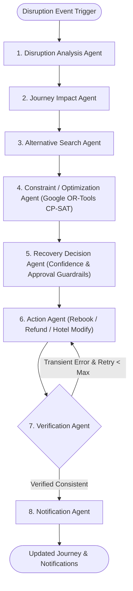

# Stage 7: Autonomous Recovery Agent Workflow (LangGraph Documentation & Visualization)

## Overview

The **Autonomous Disruption Recovery Agent** orchestrates travel disruption recovery using a stateful, 8-node **LangGraph** state machine (`StateGraph(RecoveryAgentState)`). Each node is a specialized agent that consumes and updates a strictly typed shared state (`RecoveryAgentState`) while enforcing confidence guardrails, action approval policies, and automatic retry loops.

---

## LangGraph State Machine Visualization



---

## Specialized Agents (Nodes 1–8)

| Step | Node ID | Agent Name | Responsibility |
| :--- | :--- | :--- | :--- |
| **1** | `disruption_analysis_agent` | **Disruption Analysis Agent** | Classifies disruption category (`flight_delay`, `train_cancellation`, etc.), delay magnitude, carrier fault, and severity (`LOW`, `MODERATE`, `HIGH`, `CRITICAL`). |
| **2** | `journey_impact_agent` | **Journey Impact Agent** | Evaluates downstream cascades across the journey graph to identify `affected_bookings`, `missed_connections`, `unaffected_bookings`, and hotel latest check-in cutoffs. |
| **3** | `alternative_search_agent` | **Alternative Search Agent** | Queries the decoupled `SupplierIntegrationService` (Flight, Train, and Bus Supplier Adapters) with automatic retry on transient supplier errors. |
| **4** | `constraint_optimization_agent` | **Constraint/Optimization Agent** | Formulates the 0-1 Integer Linear Program and solves it mathematically via **Google OR-Tools CP-SAT** (`ORToolsRecoveryOptimizer`). |
| **5** | `recovery_decision_agent` | **Recovery Decision Agent** | Computes `confidence_score`, enforces `approval_rules` (`auto_approve_max_cost`, `min_confidence_threshold`, `require_human_approval`), and generates the human-readable `why_selected` explanation. |
| **6** | `action_agent` | **Action Agent** | Executes approved rebooking (`POST /bookings/rebook`), involuntary refund claims (`POST /bookings/refund`), and hotel late-arrival protection (`POST /hotel/modify`) — or stages rebooking as `AWAITING_TRAVELER_APPROVAL` when guardrails require human sign-off. |
| **7** | `verification_agent` | **Verification Agent** | Audits post-action state. If a transient supplier failure (`504`/`503`) occurred and `retry_count < max_retries`, routes back to `action_agent` via a conditional edge. |
| **8** | `notification_agent` | **Notification Agent** | Dispatches notifications to the traveler (`EMAIL_AND_WEBSOCKET`) and hotel front desk (`SUPPLIER_CRS_NOTICE`) with full decision explanations. |

---

## Structured Shared State (`RecoveryAgentState`)

```json
{
  "journey_id": "JRN-101",
  "disruption": {
    "type": "flight_delay",
    "delay_minutes": 240,
    "origin": "Delhi",
    "destination": "Jaipur",
    "revised_arrival": "4:30 PM",
    "classified_severity": "CRITICAL"
  },
  "affected_bookings": [],
  "alternatives": [],
  "constraints": [],
  "selected_plan": {
    "status": "APPROVED_FOR_AUTONOMOUS_EXECUTION",
    "selected_option": {},
    "confidence_score": 0.96,
    "approval_required": false,
    "why_selected": "Train B (Vande Bharat Express) was selected because it is the earliest feasible train (departing 5:30 PM after the 60m connection buffer) that arrives at 9:00 PM before the hotel's latest check-in time (10:00 PM) while keeping the cost (INR 700.0) within the traveler's configured limit (1000.0)."
  },
  "actions": [],
  "verification": {
    "verified": true,
    "status": "VERIFIED_CONSISTENT",
    "retries_used": 0
  },
  "notifications": []
}
```
