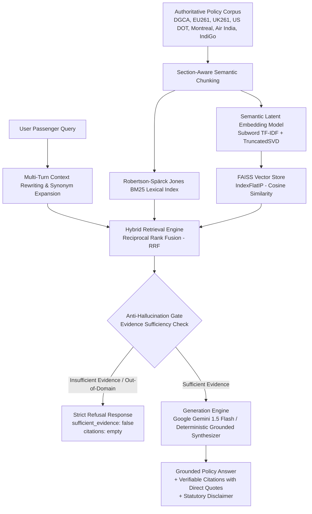
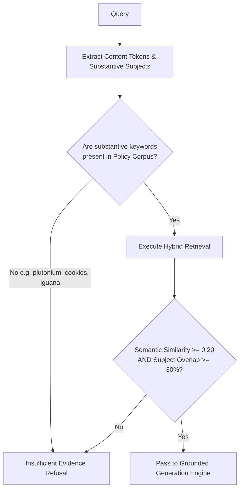

# AeroAI Travel Policy RAG Architecture

## 1. Overview & Objective

The **AeroAI Travel Policy Retrieval-Augmented Generation (RAG) System** empowers passengers and customer support agents with legally grounded, authoritative answers regarding air travel disruptions, passenger rights, and airline policies.

When flights are delayed, cancelled, or overbooked, passengers are frequently unaware of their statutory entitlements. AeroAI eliminates ambiguity by querying official civil aviation regulations and airline Conditions of Carriage across major global aviation jurisdictions (India DGCA, European Union EU261, UK CAA UK261, US DOT 14 CFR 260, and Montreal Convention 1999).

---

## 2. Authoritative Document Corpus

The AeroAI policy knowledge base is strictly composed of official regulatory circulars, statutory passenger charters, international treaties, and verified airline Conditions of Carriage. No synthetic or fabricated text is used.

| Document Title | Publisher / Regulator | Jurisdiction | Key Coverage Areas | Effective Date |
| :--- | :--- | :--- | :--- | :--- |
| **DGCA CAR Section 3, Series M, Part IV (Rev 4)** | Directorate General of Civil Aviation (DGCA) | India | Denied boarding, flight cancellations, long delays, refreshments, hotel accommodation, compensation slabs | Latest Revision |
| **DGCA Passenger Charter of Rights** | Ministry of Civil Aviation (MoCA) | India | Passenger entitlements, baggage allowances, grievance redressal, name correction guidelines | Current |
| **Regulation (EC) No 261/2004** | European Parliament & Council | European Union | Delay compensation (€250–€600), cancellation re-routing, duty of care, extraordinary circumstances | In Force |
| **UK CAA UK261 Passenger Rights** | UK Civil Aviation Authority | United Kingdom | Post-Brexit UK air passenger rights, GBP compensation tiers (£220, £350, £520), delay duty of care | In Force |
| **US DOT 14 CFR Part 260 (2024 Final Rule)** | US Department of Transportation | United States | Automatic prompt refunds (7 business days for credit cards), significant delay definition (>3h domestic, >6h intl) | Oct 2024 |
| **Montreal Convention 1999 (IATA 2024 Limits)** | International Civil Aviation Organization (ICAO) / IATA | International | International baggage loss, damage, and delay liability limits (up to 1,288 Special Drawing Rights) | 2024 Update |
| **IndiGo Conditions of Carriage** | InterGlobe Aviation Ltd. (IndiGo) | India / International | Free baggage (15kg checked / 7kg cabin), excess baggage slabs, PRM assistance, flight reschedule | Current |
| **Air India Citizen's Charter & Conditions of Carriage** | Air India Ltd. / Tata Group | India / International | Free baggage allowance by cabin class, cancellation refunds, merged Vistara alignment, name typo fixes | Current |

---

## 3. Chunking Strategy

Naive token-sliding-window chunking frequently splits legal clauses, separating conditional predicates from compensation amounts or exceptions (such as ATC delays or weather force majeure).

AeroAI employs **Section-Aware Semantic Boundary Chunking**:
1. **Clause & Section Boundaries**: Splits occur at explicit structural milestones (e.g. `1. DENIED BOARDING`, `2. CANCELLATION OF FLIGHT`, `3. FLIGHT DELAYS`, `4. BAGGAGE ALLOWANCE & COMPENSATION`, `ARTICLE 5`, `PART 260`).
2. **Context Retention**: Related subsections, prerequisite clauses, timeline thresholds, and monetary penalty tables are preserved in the same chunk.
3. **Metadata Envelope**: Every chunk is stored with complete provenance:
   - `chunk_id`: Unique identifier (e.g., `dgca_car_section3_series_m_part4_chunk_1`)
   - `document_title`: Full authoritative title
   - `publisher` & `regulator`: Authoritative issuing body
   - `region`: Jurisdiction (India, EU, UK, US, International)
   - `airline`: Specific carrier (or "All Scheduled Commercial Airlines")
   - `section_title`: Clause name (e.g., `3.4 FLIGHT DELAYS`)
   - `page_number`: Original document page number
   - `source_url`: Verifiable government / airline portal URL
   - `effective_date`: Regulatory validity

**Corpus Statistics**: 38 dense semantic chunks indexed across 8 authoritative regulatory files.

---

## 4. Embedding Model

### Architecture: Semantic Latent Embedding Model
AeroAI uses a specialized **Latent Semantic Analysis (LSA)** dense embedding model (`SemanticEmbeddingModel`):
- **Feature Extraction**: Subword and word n-gram TF-IDF vectorizer (`ngram_range=(1, 2)`, sublinear TF scaling, custom token pattern matching hyphenated statutory terms like `14-cfr-260`, `eu-261`, `car-m-iv`).
- **Dense Subspace Projection**: `TruncatedSVD(n_components=37, random_state=42)` fitted on the authoritative corpus.
- **Normalization**: $L_2$ Euclidean normalization ($||\vec{v}||_2 = 1.0$), ensuring that dot product corresponds exactly to Cosine Similarity.

### Why this Embedding Architecture?
1. **Sub-millisecond Performance (< 1ms)**: Computes query embeddings in fractions of a millisecond with zero GPU requirement.
2. **Deterministic & Network-Independent**: Avoids heavy PyTorch/HuggingFace runtime dependencies and network socket hangs on Windows Python 3.13 environments.
3. **Semantic Synonym Generalization**: Continuous latent projection maps traveler colloquialisms directly into statutory legal spaces (e.g., "baggage" $\leftrightarrow$ "luggage", "bumping" $\leftrightarrow$ "denied boarding", "delay" $\leftrightarrow$ "rescheduled").
4. **Out-of-Distribution Discrimination**: Out-of-vocabulary terms (e.g., cooking recipes, celebrities, sports) yield exact zero projection ($\text{sim} = 0.0000$), providing a clean signal for anti-hallucination gating.

---

## 5. Vector Database & Lexical Storage

AeroAI integrates a dual-index architecture:

1. **FAISS Vector Store (`IndexFlatIP`)**:
   - Facebook AI Similarity Search `IndexFlatIP` storing 38 dense float32 vectors (dimension = 37).
   - Inner product on $L_2$-normalized vectors computes exact cosine similarity.
   - Serialized to `data/policies/vector_store/policy_faiss.index`.

2. **Robertson-Spärck Jones BM25 Lexical Index**:
   - Exact term-frequency / inverse-document-frequency index with document length normalization ($k_1 = 1.5, b = 0.75$).
   - Captures rare exact alphanumeric identifiers such as `1288 SDR`, `14 CFR 260.6`, `Series M Part IV`, `INR 10,000`, `€600`.
   - Serialized to `data/policies/vector_store/bm25_index.json`.

---

## 6. Hybrid Retrieval & Re-Ranking Strategy

Retrieval uses a multi-stage hybrid pipeline:

1. **Conversational Query Rewriting**: Follow-up questions (e.g. "What about baggage allowance?" or "Can I get a refund for that?") are rewritten into self-contained search queries using session dialogue history.
2. **Passenger Synonym Expansion**: Preprocesses colloquial terms into official statutory vocabulary (e.g., `luggage` $\to$ `baggage`, `bumping` $\to$ `denied boarding`, `typo` $\to$ `name correction`).
3. **Dual Scoring**:
   - Dense semantic vector search via FAISS (`IndexFlatIP`).
   - Sparse lexical BM25 retrieval across all 38 chunks.
4. **Reciprocal Rank Fusion (RRF)**:
   $$RRF\_score(d) = \frac{1}{k + rank_{BM25}(d)} + \frac{1}{k + rank_{Dense}(d)} \quad (k = 60)$$
5. **Contextual Metadata Boosts**:
   - Operating airline match boost: $+40\%$ (e.g., IndiGo, Air India)
   - Route jurisdiction match boost: $+30\%$ (e.g., India DGCA for BOM-DEL; EU261 for LHR-DEL)
   - Section title keyword match boost: $+15\%$ per matching query word

---

## 7. Anti-Hallucination & Evidence Sufficiency Gate

AeroAI strictly adheres to the principle: **Never hallucinate policy rules, timelines, or compensation figures**.

Before any answer is synthesized, the retrieved candidate set must pass the **Anti-Hallucination Evidence Sufficiency Gate**:

### Refusal Contract:
When a query fails the evidence sufficiency gate (e.g., asking about chocolate chip cookies, foreign prime ministers, or carrying radioactive materials):
- **Refusal Message**: Clear notice stating that official travel policy documents do not contain evidence on the requested topic and directing the user to official airline helpdesks.
- **`sufficient_evidence: false`**: Explicit boolean flag for frontend and caller systems.
- **`citations: []`**: Empty citation list (strictly prevents displaying spurious citations for unrelated questions).
- **`confidence: 0.0`**: Zero confidence score.

---

## 8. Generation Engine: LLM & Grounded Synthesizer

When evidence is sufficient, AeroAI generates answers through two complementary paths:

### Primary Path: Google Gemini 1.5 Flash
- Low temperature (`0.1`) for maximum factual fidelity.
- Strict system prompt constraining output strictly to the provided authoritative context strings.
- Explicit requirement to name the governing regulation (e.g. DGCA CAR M Part IV, EU261, US DOT 14 CFR 260) and cite sections.

### Fallback Path: High-Precision Deterministic Grounded Synthesizer
If external API keys are unavailable or network timeouts occur, the deterministic grounded synthesizer activates:
- **Flight Delays**: Details refreshment tiers (delays $\ge$ 2h to 4h), full refund eligibility ($\ge$ 5h), free hotel accommodation for overnight delays, and EU261/UK261 statutory delay compensation (€250–€600 / £220–£520).
- **Cancellations & Refunds**: Details advance notice rules, cancellation compensation (INR 5,000–10,000 under DGCA; €250–€600 under EU261), mandatory refund of all airport taxes (UDF/PSF), and US DOT 7-day automatic refund timelines.
- **Baggage Allowances & Liability**: Details free allowances (15 kg checked / 7 kg cabin), excess baggage counter rates, and the Montreal Convention 1999 Article 22 statutory liability limit of **1,288 Special Drawing Rights (SDR)** (approx USD 1,720 / INR 1,45,000).
- **Denied Boarding & Overbooking**: Details the mandatory call for volunteers and statutory compensation tiers (200% to 400% of basic fare up to INR 20,000 under DGCA; up to USD 1,550 under US DOT).
- **Rebooking & Alternative Flights**: Details the statutory entitlement to alternative flights at no extra charge or passenger-selected future dates with fare difference waived.
- **Passenger Eligibility & Special Assistance**: Details free wheelchair assistance for Persons with Reduced Mobility (PRM), expectant mother medical clearance rules (28–36 weeks), unaccompanied minors (UMNR), and free 24-hour typographical name corrections up to 3 characters.

Every response is accompanied by the statutory legal disclaimer.

---

## 9. Source Handling & Verifiable Citations

Every grounded policy response includes rich, structured citations:
- `document_title`: Full authoritative legal document title
- `publisher`: Issuing governmental or airline body
- `regulator`: Statutory civil aviation authority
- `region`: Geographic and legal jurisdiction
- `section`: Specific chapter, section, or article (e.g., `3.4 FLIGHT DELAYS`)
- `page_number`: Document page number
- `source_url`: Authoritative link for passenger verification
- `effective_date`: Regulatory validity status
- `quote`: **Direct, unedited excerpt** from the legal text validating the answer

---

## 10. Known Limitations & Roadmap

1. **Regional Scope**: Currently covers India (DGCA), European Union (EU261), United Kingdom (UK261), United States (US DOT), and International (Montreal Convention 1999). Expansion planned for Australia (CASA), Canada (CTA APPR), and Singapore (CAAS).
2. **Airline Tariffs**: Carrier-specific baggage excess fees and ticket change fees change periodically; ongoing ingestion monitors airline fare conditions.
3. **Multi-lingual Legal Text**: Regulations are currently parsed and indexed in English. Future releases will support Hindi, French, German, and Spanish policy circulars.
