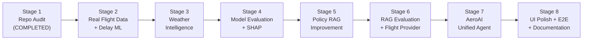

# AeroAI — Engineering Upgrade Plan

> **System Name**: AeroAI (Autonomous Disruption Recovery & Flight Intelligence)  
> **Target Standard**: Production-Grade AI/ML Engineering Portfolio Platform  
> **Branch**: `dev`  
> **Current Version**: 1.0.0 $\rightarrow$ **Target Version**: 2.0.0  
> **Document Status**: Stage 1 Audit Completed — Awaiting User Approval to proceed to Stage 2

---

## 1. Upgrade Philosophy & Working Rules

1. **Incremental Enhancement**: We build upon the solid NetworkX journey graph, OR-Tools optimizer, and FastAPI backend. We do NOT scrap existing working code.
2. **Ground Truth & Anti-Hallucination**: No invented datasets, fake metrics, or fabricated API responses. Real datasets (BTS/Kaggle) and real/verified evaluation benchmarks are used throughout.
3. **Data Leakage Prevention**: In the ML delay pipeline, features are rigorously partitioned into *Known Before Departure* (scheduled departure hour, day of week, carrier history, origin congestion, departure weather) vs. *Known After Departure* (actual departure time, taxi-out, air time).
4. **Provider Abstraction**: Flight and Weather data providers are behind clean abstract interfaces (`FlightProvider`, `WeatherProvider`) with graceful, zero-crash fallback to deterministic mock providers when offline or when API keys are absent.
5. **Runnable at Every Stage**: Automated tests (`pytest`) and frontend production builds (`npm run build`) must pass at every incremental milestone.

---

## 2. Multi-Stage Upgrade Roadmap

---

### Stage 1 — Repository Audit (COMPLETED)
- **Objective**: Conduct a thorough audit of the entire codebase (frontend, backend, ML, RAG, database, tests, APIs, configurations), document current architecture and limitations, and formulate an incremental upgrade plan.
- **Files Affected**:
  - `docs/CURRENT_ARCHITECTURE.md`: Subsystem analysis, data classification, and architecture diagrams.
  - `docs/UPGRADE_PLAN.md`: Staged blueprint with objective, files, outputs, dependencies, and risks for all stages.
- **Expected Output**:
  - Authoritative documentation of current capabilities, gaps, and technological roadmap.
  - Clear baseline test validation (57/57 backend tests passing, frontend builds without errors).
- **Dependencies**: None.
- **Risks**: Outdated documentation misleading future implementation.

---

### Stage 2 — Real Flight Data + Delay ML
- **Objective**: Introduce a real aviation dataset (BTS Airline On-Time Performance or curated Kaggle flight delay dataset with 100k+ rows), design an end-to-end reproducible training script, engineer pre-flight features without data leakage, and train baseline and gradient-boosted models for binary flight delay prediction ($\ge 15$ min delay).
- **Files Likely Affected**:
  - `data/flights/` (New): Dataset storage, ingestion script, and schema documentation (`README.md`).
  - `backend/app/ml/` (New package):
    - `data_loader.py`: Dataset loading, validation, time-based sorting.
    - `feature_pipeline.py`: Leakage-free feature transforms (scheduled hour, day of week, carrier, distance, origin/dest congestion indices).
    - `train.py`: Training script comparing Baseline (Dummy/Logistic Regression) vs. Random Forest / LightGBM / XGBoost with cross-validation.
    - `predictor.py`: Inference service loading serialized models from `backend/app/ml/artifacts/`.
  - `backend/app/api/v1/endpoints/predictions.py` (New): REST endpoint `/api/v1/predict/flight-delay`.
  - `backend/requirements.txt`: Adding `scikit-learn`, `joblib`, `pandas`, `numpy`, `lightgbm`.
  - `tests/backend/test_ml_pipeline.py` (New): Data loading, feature transformation, inference validation.
- **Expected Output**:
  - Reproducible training pipeline saving `model.joblib`, `preprocessor.joblib`, and `metrics.json`.
  - Functional delay prediction REST endpoint returning probability, binary prediction, and feature summary.
- **Dependencies**: Real dataset file (BTS/Kaggle CSV/Parquet); Python scientific packages (`scikit-learn`, `pandas`, `lightgbm`).
- **Risks**:
  - Data leakage (e.g., using `ActualDepartureTime` or `TaxiOutTime`). Mitigated by strict feature whitelisting.
  - Large dataset files bloating Git repository. Mitigated by storing raw data in `.gitignore` or generating/downloading via automated script.

---

### Stage 3 — Weather Intelligence
- **Objective**: Create a modular weather service that enriches flight data with METAR / meteorological intelligence (temperature, precipitation, wind speed, visibility, convective storm risk).
- **Files Likely Affected**:
  - `backend/app/modules/weather/` (New package):
    - `interfaces.py`: `WeatherProvider` abstract base class defining `get_weather(airport_code, timestamp)`.
    - `live_weather.py`: Implementation using Open-Meteo / Aviation Weather API (free, no API key required).
    - `mock_weather.py`: Deterministic fallback provider with preset meteorological scenarios (fog, thunderstorm, clear).
    - `service.py`: Caching and orchestration layer.
  - `backend/app/api/v1/endpoints/weather.py` (New): REST endpoint `/api/v1/weather/{airport_code}`.
  - `backend/app/ml/feature_pipeline.py`: Integration of weather features (origin/destination visibility, wind, precipitation) into the ML inference pipeline.
  - `tests/backend/test_weather_service.py` (New): Unit and fallback tests.
- **Expected Output**:
  - Live and fallback weather fetching capability.
  - Weather features injected into flight risk assessment.
- **Dependencies**: Open-Meteo API (or AviationWeather.gov); `httpx`.
- **Risks**: Network latency or rate limits from external weather APIs. Mitigated by an in-memory TTL cache and instant mock fallback.

---

### Stage 4 — Model Evaluation + SHAP Explainability
- **Objective**: Evaluate trained models with rigorous metrics (ROC-AUC, Precision, Recall, F1, Brier Score, Confusion Matrix) and implement TreeSHAP / KernelSHAP explainability to compute local feature contributions for every delay prediction.
- **Files Likely Affected**:
  - `backend/app/ml/evaluate.py`: Evaluation report generation script producing `evaluation_report.json` and metric summaries.
  - `backend/app/ml/explainability.py`: SHAP explainer service generating top positive/negative risk factors per flight.
  - `backend/app/api/v1/endpoints/predictions.py`: Enhanced endpoint returning prediction probability + top SHAP feature attributions with human-readable explanations.
  - `backend/requirements.txt`: Adding `shap`.
  - `tests/backend/test_shap_explainability.py` (New): Verifies SHAP values sum to model log-odds/margin and format properly.
- **Expected Output**:
  - Published model evaluation report with real numbers on a holdout test split.
  - API endpoint providing transparent, explainable delay risk factors (e.g., "Origin departure fog +42% delay risk").
- **Dependencies**: `shap` library; serialized model artifact from Stage 2.
- **Risks**: SHAP computation latency. Mitigated by using `shap.TreeExplainer` on tree models which computes explanations in <10ms.

---

### Stage 5 — Policy RAG Improvement
- **Objective**: Upgrade the policy RAG engine from the 128-dimensional MD5 bag-of-words hash representation to authentic dense neural vector embeddings (Sentence-Transformers / HuggingFace or ChromaDB embedding function), with enhanced chunking, metadata filtering (airline, jurisdiction, delay thresholds), and precise citation extraction.
- **Files Likely Affected**:
  - `scripts/ingest_policies.py`: Re-ingest raw documents with Sentence-Transformers (`all-MiniLM-L6-v2`) or ChromaDB dense embeddings.
  - `backend/app/modules/policies/policy_rag_service.py`: Replace MD5 hash projection with true dense vector similarity + BM25 hybrid reciprocal rank fusion.
  - `backend/requirements.txt`: Adding `sentence-transformers` (or ChromaDB dense client).
  - `data/policies/vector_store/`: Updated dense embeddings index.
  - `tests/backend/test_policy_rag.py`: Retrieval precision and citation verification tests.
- **Expected Output**:
  - Dense semantic retrieval that accurately captures travel policy concepts (e.g., "denied boarding compensation", "flight delayed > 5 hours refund").
  - Mandatory verified legal citations (document title, regulation section, page/clause).
- **Dependencies**: `sentence-transformers` or Gemini embedding API; raw policy files in `data/policies/raw/`.
- **Risks**: PyTorch / model size overhead. Mitigated by using a lightweight 80MB model (`all-MiniLM-L6-v2`) or remote embedding API.

---

### Stage 6 — RAG Evaluation + Real Flight Provider
- **Objective**: Build an automated RAG evaluation benchmark (groundedness, context relevance, answer recall) against synthetic golden Q&A pairs, and implement an abstract `FlightProvider` supporting real flight tracking (OpenSky Network / AviationStack / FlightAware) alongside the existing `MockFlightProvider`.
- **Files Likely Affected**:
  - `backend/app/modules/policies/evaluation.py` (New): Benchmark runner evaluating faithfulness, retrieval precision, and latency.
  - `backend/app/modules/suppliers/interfaces.py`: Clean `FlightStatusProvider` interface.
  - `backend/app/modules/suppliers/opensky_provider.py` (New): Live flight tracking via OpenSky Network public API.
  - `backend/app/modules/suppliers/mock_supplier.py`: Maintained as zero-config fallback.
  - `backend/app/api/v1/endpoints/suppliers.py`: Updated flight search & live status routes.
  - `tests/backend/test_rag_evaluation.py` (New): RAG benchmark test suite.
  - `tests/backend/test_flight_provider.py` (New): Provider failover tests.
- **Expected Output**:
  - Documented RAG evaluation score matrix.
  - Live flight search & status with automatic graceful mock fallback.
- **Dependencies**: OpenSky Network API (free open aviation network).
- **Risks**: OpenSky API rate limits or incomplete coverage in certain regions. Mitigated by instant automatic fallback to mock provider.

---

### Stage 7 — AeroAI AI Agent
- **Objective**: Create the unified **AeroAI Agent** that synthesizes the entire product story:
  $$\text{Flight Info} + \text{Weather} + \text{ML Delay Prediction} + \text{SHAP Explainability} + \text{Policy RAG} \longrightarrow \text{Evidence-Grounded Recommendation}$$
  The agent handles traveler inquiries, orchestrates tool calls to the predictive and retrieval modules, clearly separates observed facts from predictions, and presents actionable recommendations.
- **Files Likely Affected**:
  - `backend/app/modules/ai_agents/aero_agent.py` (New): Multi-tool orchestrator combining Flight, Weather, ML Predictor, SHAP, and Policy RAG.
  - `backend/app/modules/ai_agents/evidence_synthesizer.py` (New): Strict grounding validator separating:
    - `[OBSERVED]`: Current flight status, scheduled times, METAR weather.
    - `[PREDICTED]`: ML delay probability, expected delay duration, top SHAP drivers.
    - `[LEGAL & POLICY]`: Governing regulation (DGCA / EU261 / DOT), statutory refund/refreshment entitlement.
    - `[RECOMMENDED ACTION]`: Actionable next steps for the traveler.
  - `backend/app/api/v1/endpoints/agent.py` (New): REST & WebSocket streaming endpoints for agent queries (`/api/v1/agent/query`).
  - `tests/backend/test_aero_agent.py` (New): End-to-end multi-tool agent test suite.
- **Expected Output**:
  - Comprehensive, evidence-grounded agent query endpoint capable of answering complex traveler disruption questions with clear provenance.
- **Dependencies**: Modules from Stages 2–6.
- **Risks**: Hallucination or blurring of facts and predictions. Mitigated by structured output schema and rule-based verification filter.

---

### Stage 8 — UI + Testing + Documentation
- **Objective**: Polish the frontend to showcase the unified agent, delay prediction gauge, SHAP explanation breakdown, weather widget, and policy citation viewer; establish full end-to-end integration tests; clean up dead template files; resolve deprecations; and produce professional portfolio documentation.
- **Files Likely Affected**:
  - `frontend/src/`:
    - `components/AeroAIAgentView.jsx` (New): Primary unified intelligence interface.
    - `components/MLPredictionCard.jsx` (New): Delay risk score, probability gauge, and SHAP factor bar charts.
    - `components/WeatherWidget.jsx` (New): Departure & arrival airport weather display.
    - `components/DashboardShell.jsx`: Integrate new views into clean, intuitive navigation.
    - Clean up: Remove orphaned template files (`counter.ts`, `main.ts`, `style.css`).
  - `tests/`: End-to-end multi-agent test scenario covering full workflow.
  - `backend/app/`: Replace deprecated `datetime.utcnow()` with `datetime.now(timezone.utc)`.
  - `pytest.ini`: Add `pythonpath = backend` for zero-configuration test runs.
  - `README.md`: Upgrade to production-style portfolio documentation with architecture diagrams, setup instructions, sample queries, and benchmark results.
- **Expected Output**:
  - Stunning, responsive, dark-mode React interface.
  - 100% passing test suite without warnings.
  - Polished documentation and portfolio presentation.
- **Dependencies**: Frontend npm packages; all prior backend stages.
- **Risks**: Frontend state synchronization issues. Mitigated by reusable API hooks and mock preview data.

---

## 3. Risk Management & Fallback Matrix

| Subsystem | External Dependency | Failure Mode | Mitigation Strategy |
| :--- | :--- | :--- | :--- |
| **Flight Delay ML** | BTS Dataset / Scikit-Learn | Training file missing or corrupted | Provide automated download script with verified checksum + lightweight bundled sample. |
| **Weather Service** | Open-Meteo / METAR APIs | API timeout, HTTP 429, or offline | Catch network exceptions; return cached observation or fallback immediately to `MockWeatherProvider`. |
| **Flight Status** | OpenSky Network | Missing flight callsign or rate limit | Catch lookup failure; failover immediately to `MockFlightProvider`. |
| **RAG Embeddings** | Sentence-Transformers | GPU memory or library installation issues | Use lightweight CPU model (`all-MiniLM-L6-v2`) with in-memory caching. |
| **LLM Generation** | Google Gemini API | Missing `GEMINI_API_KEY` or quota exceeded | Fall back to deterministic evidence-grounded template synthesizer with zero hallucinations. |
