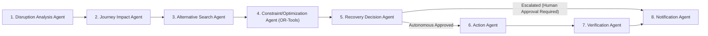

# Autonomous Multi-Agent Architecture (`docs/agents.md`)

## 1. Overview of the 8-Node LangGraph Workflow

Implemented in `backend/app/modules/ai_agents/recovery_graph.py`, the autonomous recovery engine uses **LangGraph (`StateGraph`)** with a strictly typed `RecoveryAgentState` dictionary passed across 8 specialized nodes:



---

## 2. Structured Agent State (`RecoveryAgentState`)

Every node reads from and writes to a deterministic state schema:

```json
{
  "journey_id": "1",
  "disruption": {
    "type": "flight_delay",
    "delay_minutes": 240,
    "origin": "Delhi",
    "destination": "Jaipur",
    "revised_arrival": "4:00 PM",
    "disrupted_booking_ref": "AI-202",
    "missed_booking_ref": "12015-SHT",
    "hotel_booking_ref": "HTL-JAI-101"
  },
  "affected_bookings": [],
  "alternatives": [],
  "constraints": [],
  "selected_plan": {},
  "actions": [],
  "verification": {},
  "notifications": []
}
```

---

## 3. Specialized Agent Responsibilities

1. **Disruption Analysis Agent (`disruption_analysis_node`)**
   - Normalizes raw disruption telemetry (`flight_delay`, `flight_cancellation`, `train_delay`, `train_cancellation`, `bus_cancellation`, `strike`, `weather`).
   - Computes severity classification (`CRITICAL`, `HIGH`, `MEDIUM`, `LOW`) and revised arrival timestamps.

2. **Journey Impact Agent (`journey_impact_node`)**
   - Evaluates downstream bookings in the NetworkX Journey Graph.
   - Classifies each booking as `DIRECTLY_DISRUPTED`, `MISSED_CONNECTION`, `POTENTIAL_LATE_ARRIVAL`, or `UNAFFECTED`.

3. **Alternative Search Agent (`alternative_search_node`)**
   - Queries the decoupled `SupplierIntegrationService` adapters (`TrainSupplierAdapter`, `BusSupplierAdapter`, `FlightSupplierAdapter`) for candidate replacements between the disrupted origin and destination.

4. **Constraint / Optimization Agent (`constraint_optimization_node`)**
   - Translates disruption timestamps, minimum transfer buffers, seat requirements, and hotel latest check-in cutoffs into a `OptimizationRequest`.
   - Invokes the **Google OR-Tools CP-SAT solver** (`ORToolsRecoveryOptimizer`) to rank all feasible alternatives and select the mathematically optimal transport option.

5. **Recovery Decision Agent (`recovery_decision_node`)**
   - Evaluates **Confidence Score (`0.0 – 1.0`)** and **Action Approval Rules**:
     - Escalates to human review (`requires_human_approval = True`) if:
       - No feasible alternative satisfies hard constraints (`constraints_satisfied == False`),
       - Confidence falls below the threshold (`confidence < 0.70`),
       - Net price delta exceeds the autonomous cost ceiling (`max_auto_approve_cost_inr`, default `₹2,500`), or
       - Manual approval is explicitly forced (`force_human_approval == True`).
   - Produces a human-readable rationale explaining why the selected option won and why rejected candidates failed or scored lower.

6. **Action Agent (`action_execution_node`)**
   - Compiles the approved recovery plan into atomic supplier operations (`cancel_booking`, `rebook_transportation`, `request_refund`, `modify_hotel_checkin`, `notify_traveler`, `notify_relevant_contact`) and executes them through `RecoveryActionExecutor` with idempotency keys and compensating rollback protection.

7. **Verification Agent (`verification_node`)**
   - Audits post-execution invariants: confirms replacement PNR issuance, verifies zero remaining `IMPOSSIBLE` connections, and validates whether any fallback or rollback was triggered.

8. **Notification Agent (`notification_node` & `NotificationAgentService`)**
   - Generates 6 stakeholder communications (`traveler_notification`, `hotel_notification`, `supplier_communication`, `refund_request`, `cancellation_request`, `emergency_contact_notification`) guarded by `FactGroundingValidator` to guarantee zero hallucinated booking numbers, prices, dates, or policy rules.
