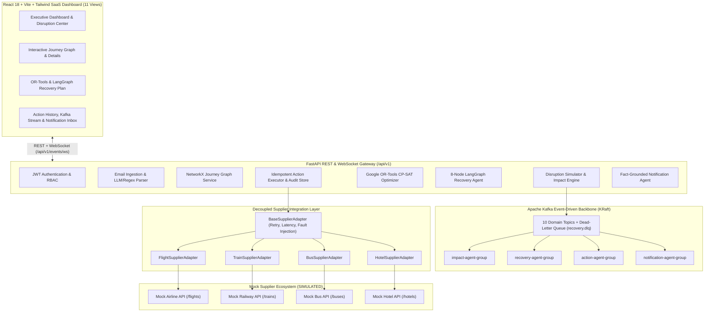

# System Architecture (`docs/architecture.md`)

## 1. High-Level System Overview

The **Autonomous Disruption Recovery Agent** is an event-driven, multi-agent travel intelligence platform that transforms disconnected travel bookings into a connected **NetworkX Directed Acyclic Journey Graph**, detects downstream cascading disruptions in real time, computes mathematically optimal recovery plans using **Google OR-Tools CP-SAT**, orchestrates autonomous decision-making via an **8-node LangGraph workflow**, executes idempotent supplier actions across a decoupled **Adapter Layer**, and streams live recovery milestones over **Apache Kafka & WebSockets**.

---

## 2. Explicit Distinction: REAL vs. SIMULATED Subsystems

To maintain architectural clarity, the platform explicitly separates **REAL** algorithmic, graph, optimization, and agentic subsystems from **SIMULATED** third-party travel supplier integrations:

| Subsystem | Classification | Implementation Details |
| :--- | :---: | :--- |
| **Email Parsing & Booking Extraction** | **REAL** | Hybrid Gemini Structured Output + deterministic regex parser (`EmailParserService`) |
| **Journey Graph & Risk Engine** | **REAL** | `networkx.DiGraph` modeling chronological, transfer, and connection edges (`SAFE`, `TIGHT`, `IMPOSSIBLE`) |
| **Disruption Cascade & Impact Analysis** | **REAL** | Graph traversal computing revised arrival times, buffer erosion, and natural-language explanations |
| **Mathematical Recovery Optimization** | **REAL** | Google OR-Tools `cp_model.CpModel` & `CpSolver` with hard constraints and configurable 6-weight objective |
| **Autonomous 8-Node Agent Workflow** | **REAL** | LangGraph `StateGraph` with confidence scoring, validation gates, and human approval escalation |
| **Kafka Event Backbone & WebSockets** | **REAL** | 10 domain topics + `recovery.dlq`, correlation IDs, idempotent consumers, retries, and live WebSocket push |
| **Anti-Hallucination Notification Validator** | **REAL** | `FactGroundingValidator` verifying zero invented booking refs, prices, dates/times, or policy numbers |
| **Idempotency & Compensating Rollback** | **REAL** | Deterministic SHA-256 idempotency keys, timeout budgets, retries, and compensating state reinstatement |
| **Airline / Train / Bus / Hotel APIs** | **SIMULATED** | In-process FastAPI Mock Supplier Ecosystem with realistic Indian Golden Triangle datasets & fault injection |
| **Email Delivery Inbox** | **SIMULATED** | Simulated SMTP/Inbox store exposing generated messages, validation badges, and metadata in the UI |

---

## 3. Core Backend Modules (`backend/app/modules/`)

- `auth/`: JWT token generation, password hashing, and user session management.
- `ingestion/`: Raw travel confirmation email ingestion, classification, and structured booking creation.
- `journeys/`: NetworkX `JourneyGraphEngine` constructing nodes (`FLIGHT`, `TRAIN`, `BUS`, `HOTEL`, `ACTIVITY`, `LOCATION`) and edges (`CONNECTION`, `TRANSFER`, `CHRONOLOGICAL`, `DEPENDENCY`).
- `disruptions/`: `DisruptionSimulatorEngine` and `ImpactAnalysisAgent` propagating delays/cancellations across downstream graph edges.
- `suppliers/`: Mock supplier datasets (`FLIGHTS_DB`, `TRAINS_DB`, `BUSES_DB`, `HOTELS_DB`), REST endpoints, and decoupled `FlightSupplierAdapter`, `TrainSupplierAdapter`, `BusSupplierAdapter`, and `HotelSupplierAdapter`.
- `optimization/`: `ORToolsRecoveryOptimizer` formulating 0-1 integer linear programs solved via Google OR-Tools CP-SAT.
- `ai_agents/`: 8-node LangGraph `StateGraph` (`DisruptionAnalysisNode` → `JourneyImpactNode` → `AlternativeSearchNode` → `ConstraintOptimizationNode` → `RecoveryDecisionNode` → `ActionExecutionNode` → `VerificationNode` → `NotificationNode`).
- `recovery/`: `RecoveryActionExecutor` and `IdempotencyAndAuditStore` executing 6 action types with retries, timeouts, partial recovery, and compensating rollback.
- `events/`: `KafkaEventBroker`, `EventDrivenRecoveryPipeline`, and `WebSocketConnectionManager`.
- `notifications/`: `NotificationAgentService` and `FactGroundingValidator` generating 6 stakeholder communications.
- `demo/`: `EndToEndDemoOrchestrator` running and verifying the 17-step Golden Triangle scenario.
