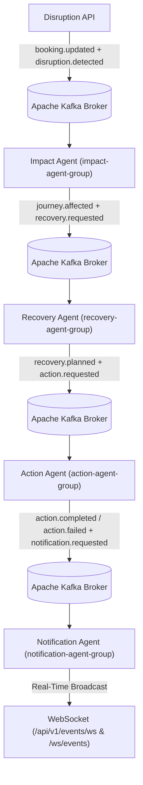

# Event-Driven Architecture with Apache Kafka (`docs/kafka-events.md`)

## 1. Event-Driven Disruption & Recovery Pipeline

Implemented in `backend/app/modules/events/kafka_engine.py` and `backend/app/modules/events/pipeline_consumers.py`, the platform uses an **Apache Kafka event-driven architecture** (with KRaft Docker Compose support in `docker-compose.yml` and an embedded high-fidelity broker for zero-dependency local testing).



---

## 2. Canonical Kafka Topics (`KafkaTopic`)

| Topic Name | Producer | Subscribed Consumer Group | Real-Time WebSocket Milestone |
| :--- | :--- | :--- | :--- |
| `booking.created` | Ingestion Service | `booking-lifecycle-group` | `"Booking created & added to graph"` |
| `booking.updated` | Disruption API | `booking-lifecycle-group` | `"Booking AI-202 updated"` |
| `disruption.detected` | Disruption API | `impact-agent-group` | `"Flight delay detected"` |
| `journey.affected` | Impact Agent | `recovery-agent-group` | `"Train connection affected"` |
| `recovery.requested` | Impact Agent | `recovery-agent-group` | `"Searching alternatives"` |
| `recovery.planned` | Recovery Agent | `action-agent-group` | `"Optimization completed"` |
| `action.requested` | Recovery Agent | `action-agent-group` | `"Executing supplier actions"` |
| `action.completed` | Action Agent | `notification-agent-group` | `"Train rebooked"`, `"Hotel updated"` |
| `action.failed` | Action Agent | `notification-agent-group` | `"Supplier action failed"` |
| `notification.requested` | Action Agent | `notification-agent-group` | `"Traveler notified"` |
| `recovery.dlq` | Kafka Broker Retry Engine | Dead-Letter Queue Inspector | `"Event routed to Dead-Letter Topic"` |

---

## 3. Event Envelope Schema (`KafkaEventEnvelope`)

Every published message conforms to a strict Pydantic schema (`backend/app/schemas/event_schemas.py`):

```json
{
  "event_id": "evt-9f8a7b6c5d4e",
  "correlation_id": "corr-104215-ai-202",
  "causation_id": "evt-1a2b3c4d5e6f",
  "topic": "disruption.detected",
  "event_type": "DISRUPTION_DETECTED",
  "timestamp": "2026-10-20T10:00:00Z",
  "version": "1.0",
  "producer": "disruption-api",
  "idempotency_key": "idem-82c91e0a44f12b90",
  "partition": 1,
  "offset": 0,
  "retry_count": 0,
  "max_retries": 3,
  "ui_message": "Flight delay detected",
  "payload": {
    "journey_id": 1,
    "booking_ref": "AI-202",
    "disruption_type": "flight_delay",
    "delay_minutes": 240
  }
}
```

---

## 4. Reliability Guarantees

- **Idempotent Consumers**: Each `KafkaConsumerGroup` maintains a ledger of processed `idempotency_key` and `event_id` values. Duplicate deliveries increment `idempotent_skips` without re-triggering downstream agents or supplier bookings.
- **Retry & Dead-Letter Topic (`recovery.dlq`)**: Transient consumer errors are automatically retried up to `max_retries`. If exhausted, the failed envelope, stack trace, and failure metadata are routed to `recovery.dlq`, where operators can inspect and replay (`POST /api/v1/events/dlq/{dlq_id}/replay`) the event once the root cause is resolved.
- **WebSocket Real-Time Updates**: Every event and milestone is pushed over `/api/v1/events/ws` (and `/ws/events`) to update the React frontend in real time.
